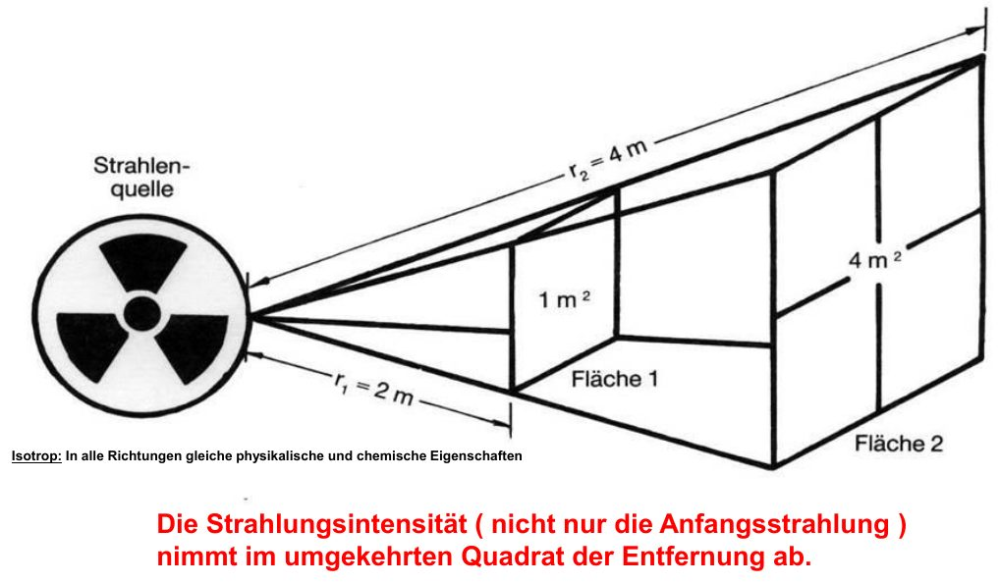
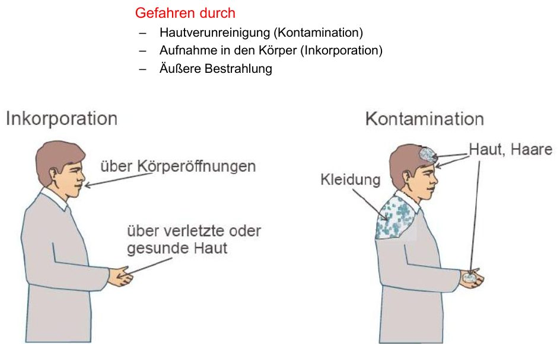
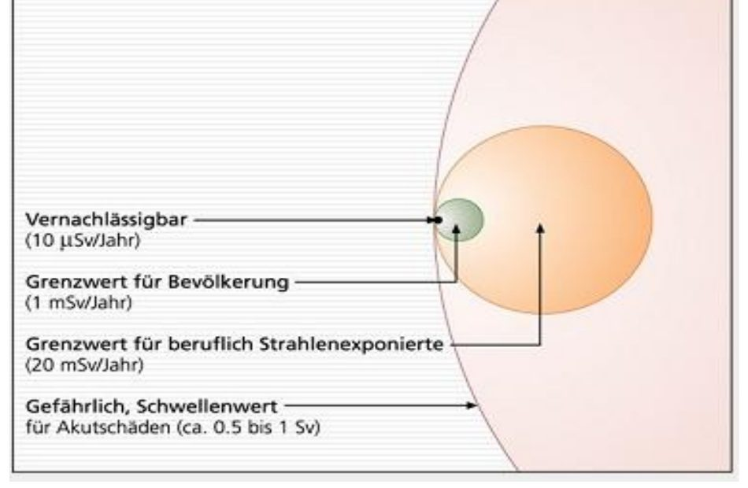
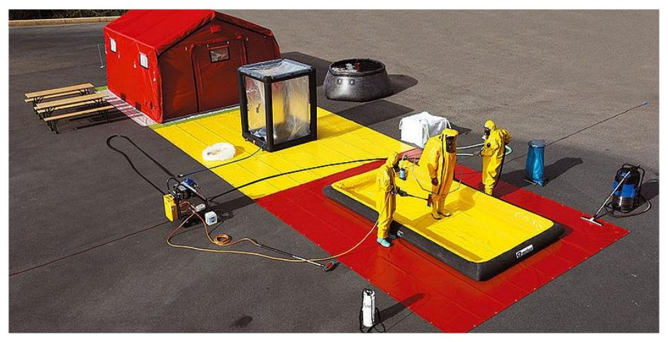
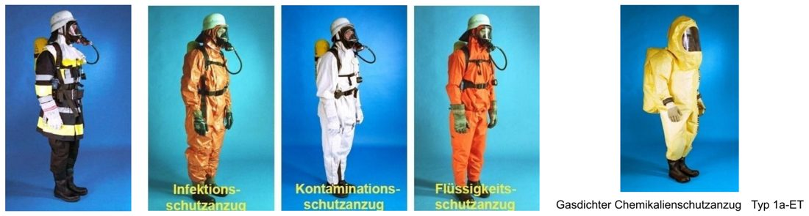
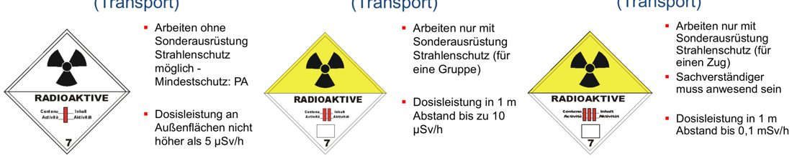

# Atomare Gefahren

## Vorkommen radioaktiver Stoffe

Industrie · Medizin (Praxen, Kliniken, Labore) · kerntechnische Anlagen · Forschung (Hochschulen) · Transporte

## Grundlagen

- Ursache: **instabile Atomkerne**, die unter Aussendung von Strahlung zerfallen.
- **Abstandsgesetz** (punktförmige Quelle): Die Strahlungsintensität nimmt mit dem **Quadrat der Entfernung** ab – doppelter Abstand = nur noch ¼ der Strahlung.

### Das Abstandsgesetz genauer erklärt

> [!MERKE] Doppelter Abstand – ein Viertel der Strahlung.

**Warum?** Eine punktförmige Quelle strahlt gleichmäßig in alle Richtungen (das meint „isotrop“), wie eine Glühbirne im dunklen Raum. Die Strahlung verteilt sich auf eine immer größere Kugeloberfläche. Bei doppeltem Radius ist die Oberfläche 2 × 2 = 4-mal so groß – dieselbe Strahlung verteilt sich auf die vierfache Fläche, also kommt an jeder Stelle nur noch ¼ an. Daher „umgekehrtes Quadrat der Entfernung“.

*Abstandsgesetz: doppelter Abstand – vierfache Fläche – ¼ der Strahlung (Folie 45)*

| Abstand | Strahlung im Vergleich zu 1 m |
|---|---|
| 1 m | 100 % |
| 2 m | 25 % |
| 3 m | ca. 11 % |
| 5 m | 4 % |
| 10 m | 1 % |
| 25 m | 0,16 % |

**Was heißt das im Einsatz?**

- **Die ersten Meter bringen am meisten:** Von 1 m auf 2 m ist ein riesiger Unterschied, von 20 m auf 21 m kaum noch. Ein paar Schritte zurück sind die einfachste Schutzmaßnahme.
- **Nie mit der Hand anfassen:** Direkt an der Quelle ist die Strahlung extrem hoch. Zange oder Stiel nutzen – schon wenige Zentimeter mehr Abstand helfen enorm.
- **25-m-Grenze:** Dort ist die Strahlung einer typischen Quelle so weit abgefallen, dass gesammelt und abgesperrt werden kann.
- Das Abstandsgesetz ist das erste A der **AAA-Regel** (Abstand – Aufenthaltsdauer – Abschirmung).

**Einschränkungen:** Das Gesetz gilt genau nur für eine punktförmige Quelle (z. B. kleines Präparat). Bei großflächig verteiltem oder ausgelaufenem Stoff gilt es nur näherungsweise. Laut Folie gilt es für die gesamte Strahlungsintensität – „nicht nur die Anfangsstrahlung“.

### Strahlungsarten

| Art | Reichweite in Luft | Abschirmung | Hauptgefahr |
|---|---|---|---|
| **Alpha (α)** | wenige cm | Papier, Kleidung (durchdringt die Haut nicht) | sehr stark schädigend bei **Inkorporation** |
| **Beta (β)** | einige Meter | dünnes, dichtes Material (z. B. Aluminiumplatte) | Inkorporation, Kontamination, äußere Bestrahlung (dringt wenige mm in den Körper) |
| **Gamma (γ)** | abhängig von der Intensität | nur teilweise durch dickes, dichtes Material (Blei, Beton) | durchdringt den Körper – schädigend in allen Fällen |

### Gefahren und Folgen

*Inkorporation und Kontamination (Folie 50)*

- **Kontamination** (Verunreinigung der Haut/Kleidung), **Inkorporation** (Aufnahme in den Körper), **äußere Bestrahlung**
- Akute Strahlenkrankheit (Übelkeit, Erbrechen, Haarausfall; bei massiver Dosis tödlich)
- Spätschäden (Krebs, Leukämie) und genetische Schäden

### Dosiswerte zur Einordnung

*Bedeutung der Dosiswerte (Folie 69)*

- Vernachlässigbar: 10 µSv/Jahr
- Grenzwert Bevölkerung: 1 mSv/Jahr
- Grenzwert beruflich Strahlenexponierte: 20 mSv/Jahr
- Akutschäden ab ca. 0,5–1 Sv

## GAMS-Regel

| | Schritt | Inhalt |
|---|---|---|
| **G** | Gefahr erkennen | Lage erkunden (4A-C-4E, Art/Ursache/Umfang), Stoffinfos (Aggregatzustand, Gefahr- und Stoffnummer, Produktname, Gefahrzettel), Freisetzung (Art, Menge, Abdrift mit dem Wind), Lagemeldung |
| **A** | Absperren und Absichern | Windrichtung beachten; Absperrbereich mind. 50 m, bei Strahlung 25 m Gefahrenbereich, bei Explosionsgefahr 100–1000 m; Fahrzeuge außerhalb; Zündquellen vermeiden; 3-facher Brandschutz (Wasser, Schaum, Pulver); Druckbehälter kühlen; Gefahrenbereich räumen; Gefahrstoffe behelfsmäßig eingrenzen; Technik (Strom, Licht, Rettungsgerät) vorbereiten |
| **M** | Menschenrettung durchführen | Mindestschutz: Schutzkleidung + Pressluftatmer; Verletzte an der Absperrgrenze an den Rettungsdienst übergeben; Kontaminationsverschleppung vermeiden |
| **S** | Spezialkräfte anfordern | Fachkräfte/Fachberater, Fachbehörden, Sachkundige; Anfahrtswege und Bereitstellungsräume festlegen; Unterstützung durch die Leitstelle |

## Einsatzgrundsätze Strahlenschutz

*Aufbau eines Dekon-Platzes (Folie 61)*

- Im Gefahrenbereich Schutzausrüstung und Atemschutz; offene Hautstellen abdecken.
- Nicht essen, trinken oder rauchen.
- Kräfte mit offenen Wunden nicht einsetzen.
- **A-A-A:** **Abstand** halten (mind. 25 m), **Aufenthaltsdauer** begrenzen, **Abschirmung** nutzen.
- So wenige Einsatzkräfte wie nötig.
- Verletzte an den Rettungsdienst übergeben, mit Hinweis auf Strahlung/Kontamination/Inkorporation; Transport auch ohne Kontaminationsnachweis.
- Nach der Rettung: Trupps außerhalb des 25-m-Bereichs sammeln (Sammelplatz gehört in den Absperrbereich), Atemschutz so lange wie möglich tragen, später durch Strahlenschutzkräfte auf Kontamination prüfen lassen.
- Dekon-Platz kann behelfsmäßig z. B. aus Leiterteilen aufgebaut werden.

## Persönliche Schutzausrüstung

*Schutzform 1, 2 und 3 (Folie 63–65)*

- **Atemschutz:** Filtergerät ABEK2-P3 oder Isoliergerät (Pressluftatmer)
- **Schutzform 1:** Feuerschutzkleidung mit Kontaminationsschutzhaube
- **Schutzform 2:** zusätzlich Kontaminationsschutzanzug
- **Schutzform 3:** gasdichter Chemikalienschutzanzug (Typ 1a-ET)

## Transportkennzeichnung nach Aktivität

*Gefahrzettel I-WEISS, II-GELB, III-GELB (Folie 66–68)*

| Kategorie | Dosisleistung | Arbeiten |
|---|---|---|
| I-WEISS | an der Oberfläche max. 5 µSv/h | ohne Sonderausrüstung Strahlenschutz möglich (Mindestschutz: PA) |
| II-GELB | in 1 m Abstand bis 10 µSv/h | nur mit Sonderausrüstung Strahlenschutz (für eine Gruppe) |
| III-GELB | in 1 m Abstand bis 0,1 mSv/h | nur mit Sonderausrüstung (für einen Zug), Sachverständiger muss anwesend sein |
