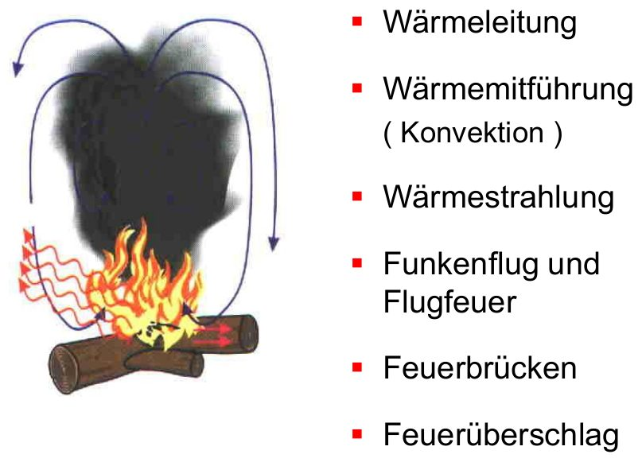
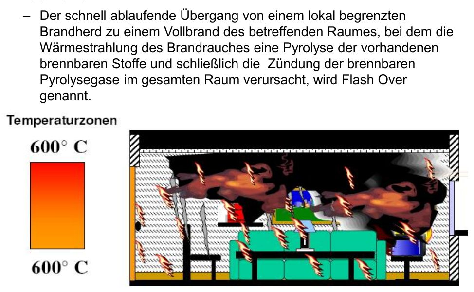
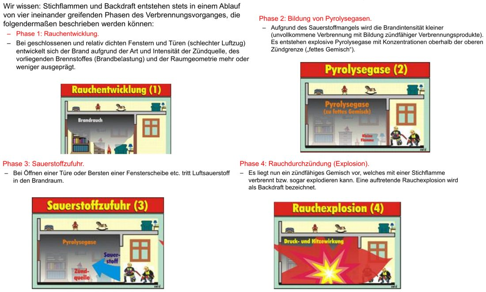
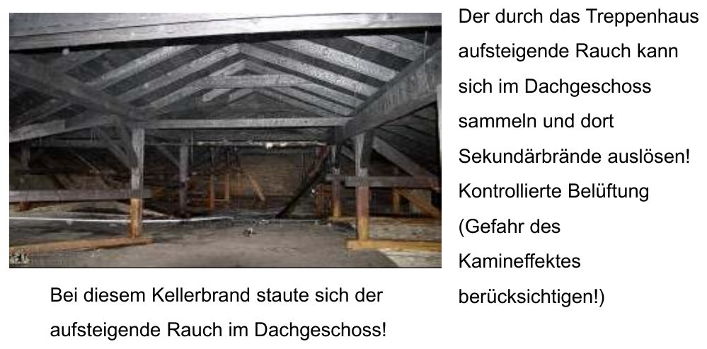
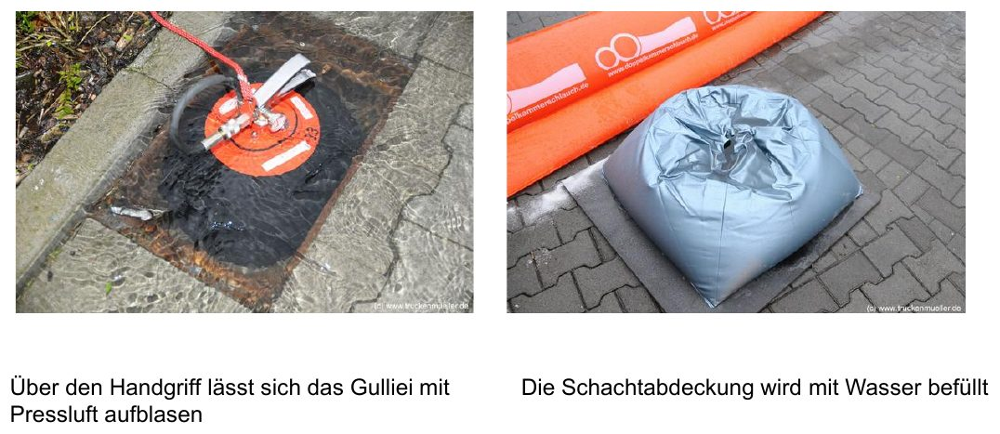
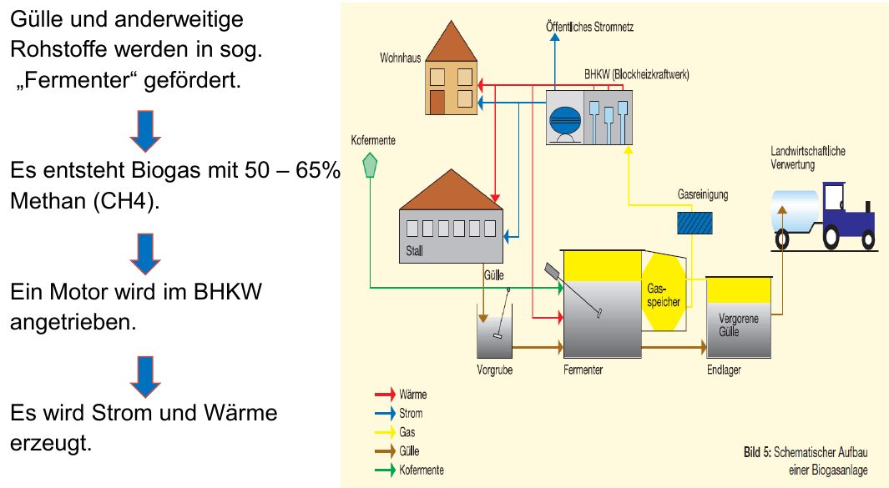

# Ausbreitung

**Ausbreitung** ist der Sammelbegriff für alles, was den Schaden räumlich vergrößert: Brand, Rauch, auslaufende wassergefährdende Flüssigkeiten, abfließendes verunreinigtes Löschwasser – aber z. B. auch Auffahrunfälle an Verkehrsunfallstellen.

## Brandausbreitung

- Kann Rettungs- und Rückzugswege abschneiden, Brandverletzungen verursachen und den Sachschaden vergrößern.
- Anhäufungen leicht brennbarer Stoffe beschleunigen die Ausbreitung.
- Die Geschwindigkeit hängt von der Entzündbarkeit ab: Zündtemperatur, Oberfläche, Wassergehalt.

### Formen der Wärmeausbreitung

*Formen der Wärmeausbreitung (Folie 74)*

| Form | Erklärung | Beispiel |
|---|---|---|
| **Wärmeleitung** | Übertragung von Teilchen zu Teilchen in festen Stoffen, v. a. Metallen | Heizungsrohre, Stahlträger |
| **Wärmeströmung (Konvektion)** | an ein strömendes Medium (Gas, Flüssigkeit) gebunden; erwärmte Gase dehnen sich aus und steigen auf | Rauch im Treppenhaus, Kamineffekt |
| **Wärmestrahlung** | an kein Medium gebunden, breitet sich mit Lichtgeschwindigkeit in alle Richtungen aus – auch gegen den Wind | Entzündung von Nachbargebäuden |
| **Flugfeuer** | brennende Teile werden durch Thermik/Wind fortgetragen und zünden woanders | Dach- und Waldbrände |
| **Funkenflug** | kleinste glühende Teilchen, verlöschen schnell; zünden nur leicht entzündliche Stoffe | Heu, Stroh, Späne |
| **Feuerbrücken** | eingebaute oder falsch gelagerte brennbare Stoffe, über die das Feuer von Objekt zu Objekt läuft | Gebäude → Gebäude, Gebäude → Wald, unterirdisch bei Moor-/Heidebränden |
| **Feuerüberschlag** | Feuer schlägt z. B. über Fenster in das nächste Geschoss | Fassadenbrand |

## Flash-Over (Rauchdurchzündung)

*Flash-Over: Rauchschicht über 600 °C (Folie 85)*

Schneller Übergang von einem örtlich begrenzten Brand zum **Vollbrand des ganzen Raumes**: Die Wärmestrahlung der heißen Rauchschicht zersetzt alle brennbaren Stoffe (Pyrolyse), bis die Pyrolysegase im gesamten Raum zünden.

**Vorstufe Rollover:** Pyrolysegase mischen sich am Rand der Rauchschicht mit Luft und zünden dort – „Flammenzungen“ (Flashflames) laufen durch die Rauchschicht.

### Anzeichen

- Extrem starker Temperaturanstieg
- „Greifbarer“, heißer (> 500 °C), dichter Rauch, der dynamisch austritt
- Flammenzungen an der Grenze Rauch/Luft (Rollover)
- Pulsierende Rauchschicht

### Maßnahmen

- Sprühimpuls-Löschverfahren in die Rauchschicht (nicht mit dem CM-Strahlrohr)
- Ventilation (Überdruck- oder hydraulische Ventilation), RWA auslösen
- Fenster öffnen / von außen einschlagen, Dachhaut öffnen

**Ziel der direkten Brandbekämpfung:** weniger Brand, Wärme, Atemgifte, Sichtbehinderung und Wasserdampf – mehr Sicherheit für den Trupp.

## Backdraft (Rauchexplosion)

*Die 4 Phasen des Backdrafts (Folie 92–95)*

Explosion von **Schwel- und Pyrolysegasen** nach plötzlicher Luftzufuhr. Ablauf in 4 Phasen:

1. **Rauchentwicklung** in einem weitgehend geschlossenen Raum
2. **Bildung von Pyrolysegasen:** Sauerstoffmangel, Brand wird kleiner, es entsteht ein „fettes“ Gemisch über der oberen Explosionsgrenze
3. **Sauerstoffzufuhr:** Tür wird geöffnet oder Scheibe birst
4. **Rauchdurchzündung (Explosion):** das Gemisch wird zündfähig, Stichflamme bzw. Explosion (Temperaturen > 1000 °C)

### Anzeichen

- Späte Branderkennung, spätes Eintreffen der Feuerwehr
- Geschlossener Raum mit warmer/heißer Türklinke oder Schließzylinder
- Verrußte Scheiben, dichter Rauch aus Tür- und Fensterspalten
- Luftzuggeräusche, Luft wird beim Öffnen in den Raum gesogen (Unterdruck) → **Tür sofort wieder schließen**
- Pulsieren / „Lokomotiveffekt“

### Gegenmaßnahmen

- Rauchabzug schaffen (Fenster, Türen o. ä. aus gesicherter Deckung öffnen)
- Geeignetes Strahlrohr vornehmen (z. B. Hohlstrahlrohr)
- Bei akuter Gefahr: Rauchexplosion gezielt auslösen, z. B. durch Einschlagen eines Fensters

## Ausbreitung von Rauch und Schadstoffen

*Rauch aus einem Kellerbrand staut sich im Dachgeschoss (Folie 101)*

- Im Freien breiten sich Atemgifte hauptsächlich **mit dem Wind** aus – Gefährdung Unbeteiligter.
- In Gebäuden breitet sich Rauch über Öffnungen, Gänge, Schächte und Kanäle aus. Hauptgefahr sind die enthaltenen Atemgifte.
- Rauch aus einem Kellerbrand kann sich im Dachgeschoss stauen und dort Sekundärbrände auslösen – kontrolliert belüften, Kamineffekt beachten.

### Schwere und leichte Gase

Vergleich: trockene Luft 28,94 g/mol.

- **Leichter als Luft** → sammelt sich oben: Methan/Erdgas (16 g/mol), z. B. im Dachbereich; CO (28 g/mol) nur knapp leichter, verteilt sich fast gleichmäßig
- **Schwerer als Luft** → sammelt sich in Kellern und Schächten: CO₂ (44 g/mol)
- Faulgase sammeln sich in Kanalisation und Jauchegruben

## Belastetes Löschwasser

*Gulliei und Schachtabdeckung zur Löschwasserrückhaltung (Folie 110)*

- Mit giftigen oder ätzenden Stoffen belastetes Löschwasser zurückhalten (z. B. Kanalabdeckungen, aufblasbares „Gulliei“, Schachtabdeckung mit Wasserfüllung, Kombischott).
- Wenn das anfangs nicht möglich ist: passende Einheiten nachfordern.
- Immer messtechnisch prüfen und ggf. entsorgen lassen.

## Ausbreitung durch Fehler und Mängel

### Löschtechnische Fehler

- Falsches Löschmittel
- Vollstrahl auf Staub → Staubexplosion
- Kaminbrände mit Wasser löschen
- Wasser in Säuren spritzen
- Behälter mit brennbaren Flüssigkeiten durch zu viel Löschwasser überlaufen lassen; bei langer Branddauer **Boilover** (Überkochen)
- **Fettexplosion:** Wasser verdampft schlagartig in heißem Fett
- **Staubexplosion:** Aufwirbeln feiner Stäube durch Löschstrahl oder Luftzug (Holzverarbeitung, Kohle, Lebensmittel, Textil)

### Betriebliche und bauliche Mängel

- Offen festgestellte Feuerschutzabschlüsse, brennbares Material an ungeeigneten Stellen, fehlende Löscheinrichtungen
- Unerlaubte Öffnungen in Brandwänden oder Decken, falsch abgehängte Decken, Lüftungs- und Kabelkanäle ohne Brandschutz – oft schwer zu erkennen

## Sonderfall Biogasanlage

*Funktionsweise einer Biogasanlage (Folie 119)*

Gülle und andere Rohstoffe werden im **Fermenter** vergoren; das entstehende Biogas treibt im Blockheizkraftwerk (BHKW) einen Motor an, der Strom und Wärme erzeugt.

| Eigenschaft | Wert |
|---|---|
| Zusammensetzung | Methan ca. 50–80 %, CO₂ 20–50 %, Spuren von H₂S, NH₃, H₂, N₂, CO |
| Dichte | ca. 1,22 kg/m³ (Luft 1,29) – etwas leichter als Luft |
| Zündtemperatur | ca. 700 °C |
| Explosionsbereich | ca. 6–12 Vol.-% |
| Geruch | faule Eier (H₂S) – **Geruchssinn wird betäubt!** |
| Wassergefährdung | WGK 1 |

**Gefahren:** Atemgift, Brandausbreitung, Ansteckung, Umwelt, Absturz/Einsturz, Explosion, Elektrizität.

**Einsatzhinweise:** Anfahrt mit dem Wind beachten, Verletzte retten, Brand am BHKW/Fermenter, Austritt von Gas oder Substrat, Brand an elektrischen Anlagen.

> [!WARNUNG] Am BHKW den **Not-Aus-Schalter** betätigen.
