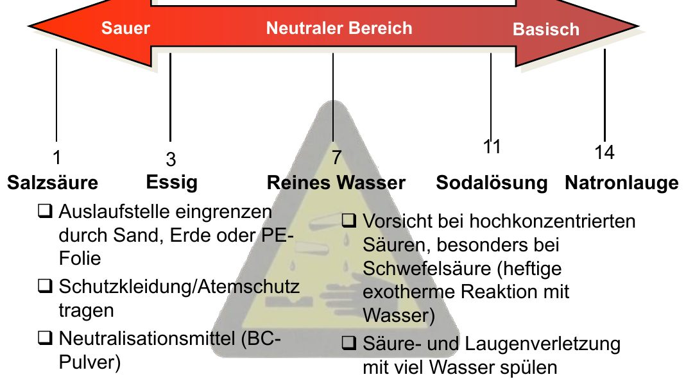
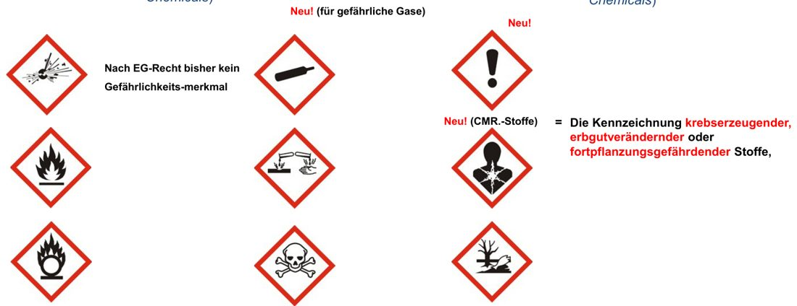
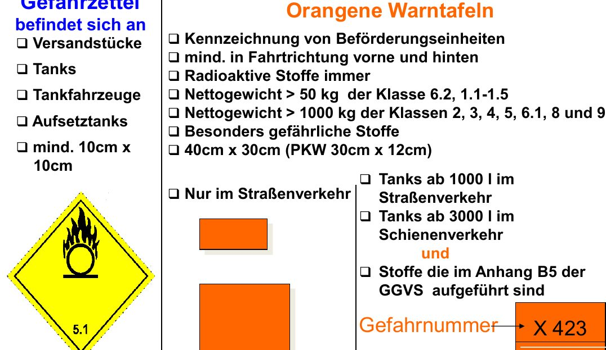
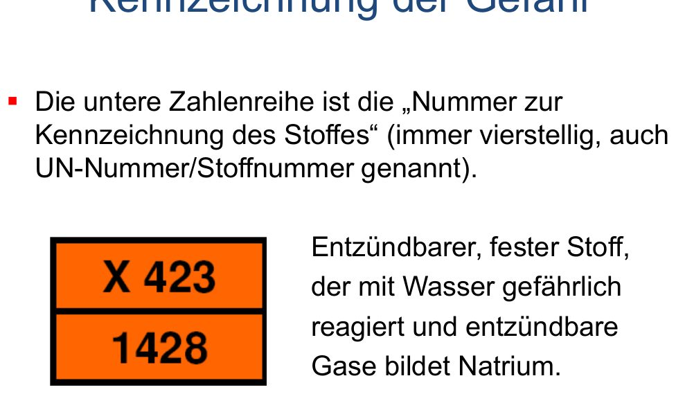
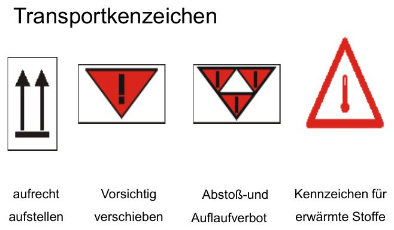
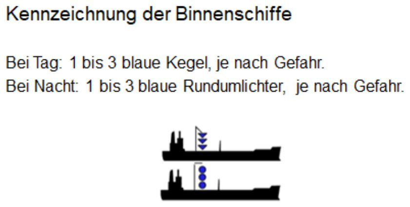
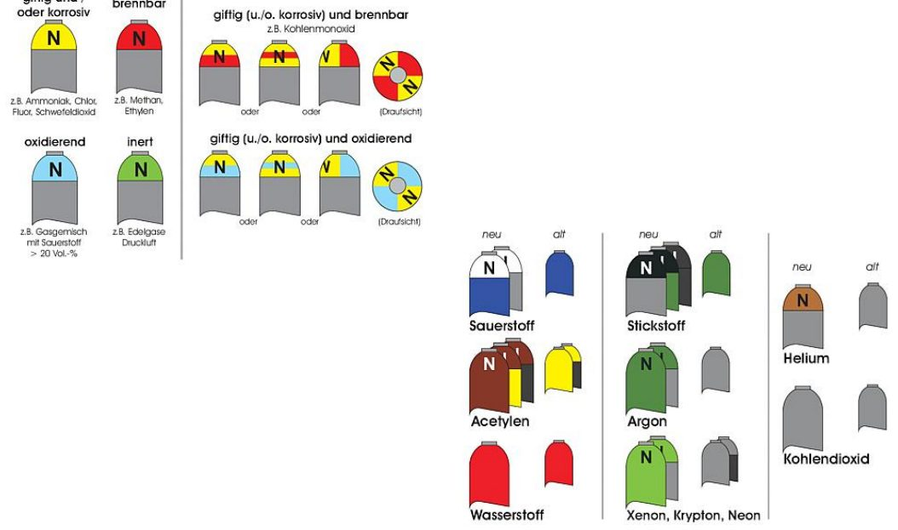

# Chemische Gefahren und Gefahrgut

## Grundlagen

- „Chemische Stoffe“ ist ein Sammelbegriff für feste, flüssige und gasförmige Stoffe mit gefährlichen Eigenschaften – relevant bei Bränden und bei technischer Hilfe.
- **Gefahren:** Atemgifte (Gase, Dämpfe, Stäube), ätzend, giftig, erbgutschädigend
- **Zusatzgefahren:** Brand und Explosion, Selbstentzündung, gefährliche Reaktionen

## Säuren und Laugen

*pH-Skala und Maßnahmen (Folie 129)*

- Verursachen Verätzungen von Augen, Haut und Atemwegen und zerstören Kleidung und Gerät. Ihre Dämpfe sind Atemgifte.
- Vorkommen: Gewerbe, Transporte in Tanks und Behältern.
- pH-Skala: 1 Salzsäure · 3 Essig · 7 reines Wasser (neutral) · 11 Sodalösung · 14 Natronlauge

> [!MERKE] **Erst das Wasser, dann die Säure – sonst geschieht das Ungeheure!** Vorsicht v. a. bei konzentrierter Schwefelsäure: heftige Reaktion mit Wasser.

**Maßnahmen:** Austrittsstelle mit Sand, Erde oder PE-Folie eingrenzen · Schutzkleidung und Atemschutz · Neutralisationsmittel (z. B. BC-Pulver) · Verätzungen mit viel Wasser spülen.

## Stickstoffhaltige Düngemittel

- Vorkommen: Landwirtschaft, Raiffeisen-/Genossenschaftslager. Erkennbar an „…stickstoff“, „Nitro…“, „Salpeter…“, „Ammonium…“ oder „N“.
- Zersetzen sich über 130 °C; nimmt man die Wärme weg, stoppt die Zersetzung.
- Es entstehen rötlich-braune (**Nitrose Gase**) und weißliche (**Ammoniak**) Schwaden – beide Atemgifte der Gruppe 2.

## Mineralölprodukte

**Grundwasserschädigend**, je nach Art **Brand- und Explosionsgefahr**.

## Brennbare Flüssigkeiten – Flammpunkt

| Einstufung (CLP) | Kriterium | Beispiele |
|---|---|---|
| H224 – extrem entzündbar | Flammpunkt < 23 °C und Siedepunkt ≤ 35 °C | Diethylether |
| H225 – leicht entzündbar | Flammpunkt < 23 °C, Siedepunkt > 35 °C | Benzin (unter −20 °C), Spiritus (ca. 12 °C) |
| H226 – entzündbar | Flammpunkt 23–60 °C | Testbenzin (ca. 30–40 °C) |
| nicht eingestuft | Flammpunkt > 60 °C | schweres Heizöl, Phenol (79 °C) |

Weitere: H261 – entwickelt mit Wasser entzündbare Gase; H250 – selbstentzündlich an der Luft.

<!-- ausgeblendet:
> [!FEHLER] Die Folien nutzen hier noch die alten Grenzen (0 / 21 / 55 °C) und Symbole F / F+ aus dem abgelösten Stoffrecht. Oben stehen die aktuellen CLP-Werte.
-->

## GHS-Piktogramme

*GHS-Piktogramme (Folie 135–136)*

Gefahrstoffe in Verpackungen werden mit den 9 GHS-Piktogrammen (rote Raute) gekennzeichnet, z. B. Flamme, Totenkopf, Ätzwirkung, Gasflasche (**neu** für Gase unter Druck) und Gesundheitsgefahr (**neu** für CMR-Stoffe: krebserzeugend, erbgutverändernd, fortpflanzungsgefährdend).

## Gefahrklassen nach ADR

| Klasse | Stoffe |
|---|---|
| 1 (1.1–1.6) | Explosive Stoffe und Gegenstände |
| 2 | Gase (verdichtet, verflüssigt, gelöst) |
| 3 | Entzündbare flüssige Stoffe |
| 4.1 / 4.2 / 4.3 | Entzündbare feste Stoffe / selbstentzündliche Stoffe / Stoffe, die mit Wasser entzündbare Gase bilden |
| 5.1 / 5.2 | Entzündend (oxidierend) wirkende Stoffe / organische Peroxide |
| 6.1 / 6.2 | Giftige Stoffe / ansteckungsgefährliche Stoffe |
| 7 | Radioaktive Stoffe |
| 8 | Ätzende Stoffe |
| 9 | Verschiedene gefährliche Stoffe und Gegenstände |

## Transportkennzeichnung

*Gefahrzettel und orange Warntafel (Folie 141)*

**Gefahrzettel (Raute):** an Versandstücken, Tanks, Tankfahrzeugen, Aufsetztanks; mind. 10 × 10 cm; zeigt die Gefahrklasse.

**Orange Warntafel:** an Beförderungseinheiten, vorn und hinten, 40 × 30 cm. Mit Nummern bei Tanks / bestimmten Stoffen: **oben Gefahrnummer, unten UN-Nummer** (Stoffnummer, immer 4-stellig).

### Gefahrnummer (obere Zahl)

*Beispiel: X 423 / 1428 = Natrium (Folie 262)*

| Ziffer | Bedeutung |
|---|---|
| 2 | Entweichen von Gas durch Druck oder chemische Reaktion |
| 3 | Entzündbarkeit von Flüssigkeiten, Dämpfen, Gasen |
| 4 | Entzündbarkeit fester Stoffe |
| 5 | Oxidierende (brandfördernde) Wirkung |
| 6 | Giftigkeit oder Ansteckungsgefahr |
| 7 | Radioaktivität |
| 8 | Ätzwirkung |
| 9 | Gefahr einer spontanen, heftigen Reaktion |

- Reicht eine Ziffer, wird eine **0** angehängt (z. B. 30 = entzündbare Flüssigkeit).
- **Verdopplung** = Verstärkung der Gefahr (z. B. 33, 88).
- **X** davor = reagiert gefährlich mit Wasser → kein Wasser!
- Beispiele: 22 tiefgekühltes Gas · 72 radioaktives Gas · X886 stark ätzend, giftig, reagiert gefährlich mit Wasser · **X423 / 1428 = Natrium** (entzündbarer fester Stoff, bildet mit Wasser entzündbare Gase)

### Weitere Kennzeichnungen

*Transport-Zusatzzeichen (Folie 140)*

*Blaue Kegel bzw. Lichter an Binnenschiffen (Folie 146)*

*Farbkennzeichnung von Gasflaschen (Folie 152)*

- **Zusatzzeichen:** aufrecht stellen, vorsichtig verschieben, Abstoß- und Auflaufverbot, erwärmte Stoffe.
- **Schiffe (blaue Kegel/Lichter):** 1 Kegel = feuergefährliche Ladung · 2 Kegel = Ammoniak o. ä. (gesundheitsgefährlich) · 3 Kegel = explosionsgefährliche Ladung.
- **Gasflaschen:** Gefahrgutaufkleber mit Gefahrzettel, Gefahren- und Sicherheitshinweisen, Zusammensetzung, Produktname, EG-Nummer bzw. „Gasgemisch“, Benennung nach ADR, Herstelleradresse; dazu Farbkennzeichnung an der Schulter.

### Kleinstmengen

Privat dürfen ohne Gefahrgutvorschriften z. B. Kraftstoff bis 60 l je Kanister und 240 l je Fahrzeug transportiert werden. Ladungssicherung trotzdem beachten.

## Vorgehen bei Gefahrgutunfällen

Nach der **GAMS-Regel**: Gefahr erkennen – Absperren – Menschenrettung – Spezialkräfte anfordern (Details auf der Seite „Atomare Gefahren“).
