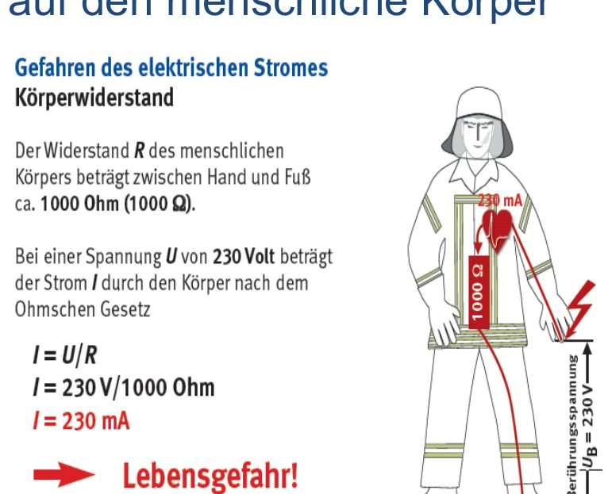
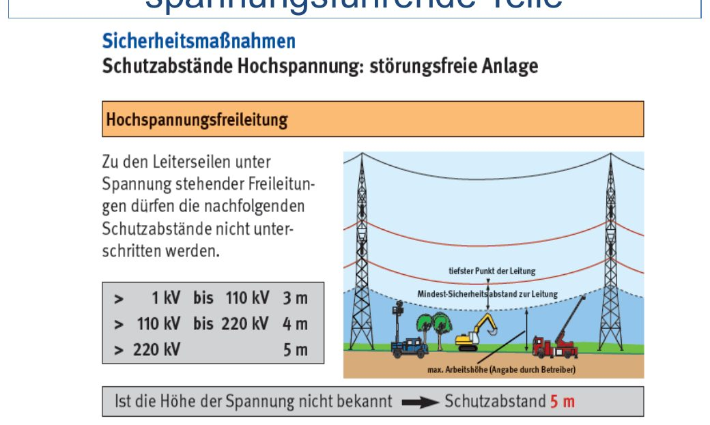
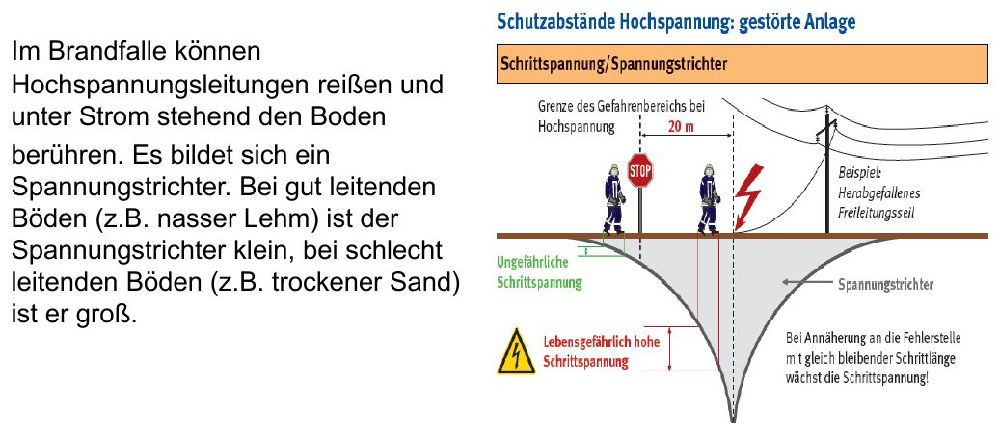
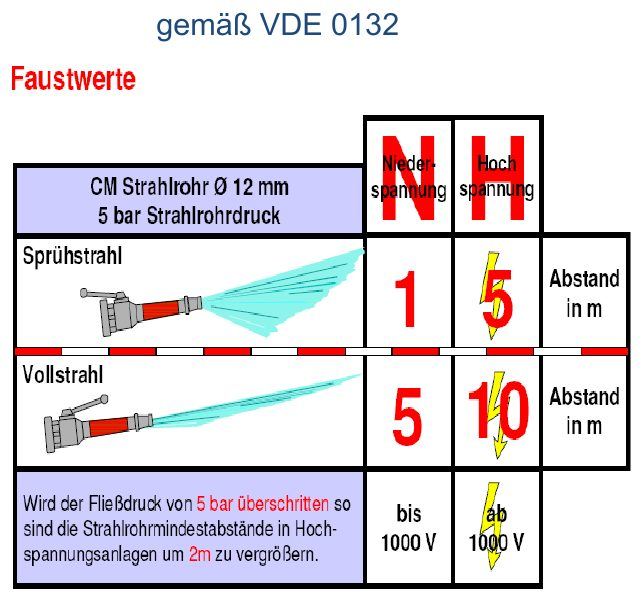
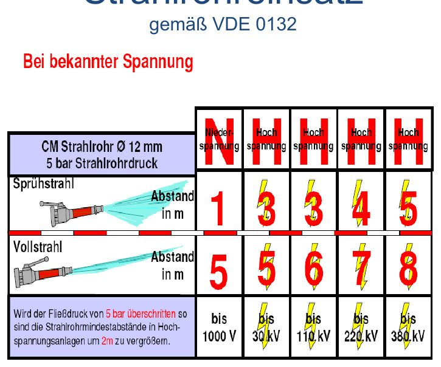
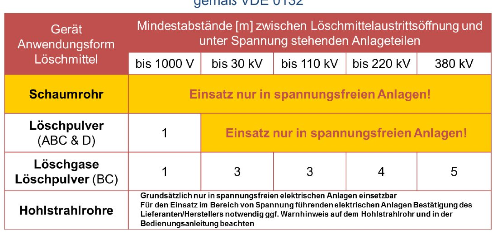
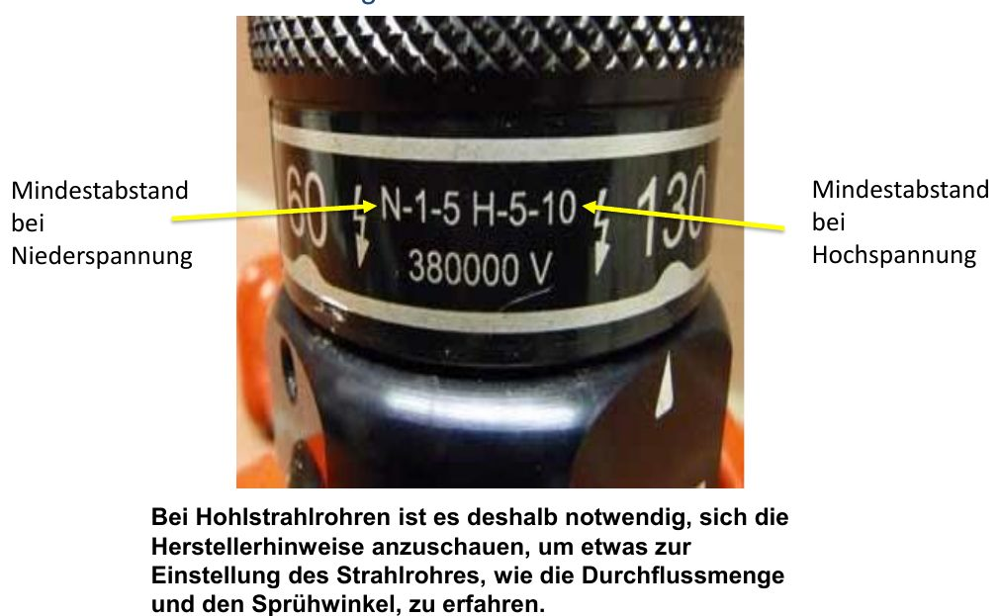
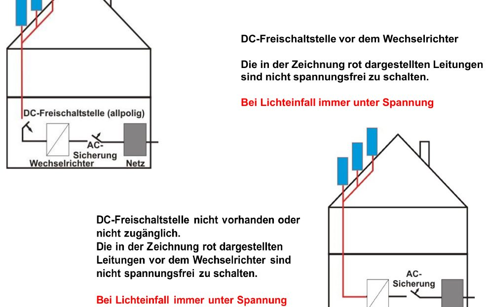

# Elektrizität

## Wo treffen wir auf Strom?

Haushalte · Gewerbe (Kfz-Werkstätten, Metallbetriebe) · Industrie · Energieversorger (Kraftwerke, Trafostationen, Freileitungen) · Bahn und Straßenbahn · PV-Anlagen. Gefahr besteht an fast jeder Einsatzstelle – gefährlich ist das **Berühren spannungsführender Teile**.

## Wirkung auf den Körper

*Körperwiderstand und Ohmsches Gesetz: 230 V → 230 mA (Folie 159)*

Entscheidend ist die **Stromstärke**; ab ca. **50 mA** drohen schwere Schäden:

1. Muskelverkrampfungen (man kann nicht mehr loslassen)
2. Herzrhythmusstörungen bis Kammerflimmern oder Herzstillstand
3. Störungen des Nervensystems
4. Verbrennungen (auch innerlich)
5. Folgeverletzungen, z. B. durch Sturz

## Gefahr beseitigen: Freischalten

- Gewerbe/Industrie: Fachpersonal des Betreibers bzw. Energieversorgers
- Hochspannung: nur der Energieversorger
- Straßenbahn: der Betreiber
- Deutsche Bahn: über den Notfallmanager

> [!WARNUNG] **Sicherheitsabstände** einhalten, bis feststeht, dass die Anlage abgeschaltet und – bei Hochspannung – zusätzlich **geerdet** ist. Die **Abschaltung** erfolgt durch den Betreiber, die **Freimeldung** nur **persönlich an den Einsatzleiter** durch verantwortliches Betriebspersonal.

## Sicherheitsabstände für Mannschaft und Gerät

*Schutzabstände an Hochspannungsfreileitungen (Folie 161)*

| Spannung | Mindestabstand |
|---|---|
| bis 1 kV (Niederspannung) | 1 m |
| über 1 kV bis 110 kV | 3 m |
| über 110 kV bis 220 kV | 4 m |
| über 220 kV (bis 380 kV) | 5 m |
| **Spannung unbekannt** | **5 m** |
| Bahn-Oberleitung (15 kV) | laut Folien 5 m |
| Straßenbahn (< 1 kV) | 1 m |

### Spannungstrichter

*Spannungstrichter und Schrittspannung (Folie 163)*

Reißt eine Hochspannungsleitung und liegt auf dem Boden, entsteht rundherum ein Spannungstrichter. Bei gut leitendem Boden (nasser Lehm) ist er klein, bei schlecht leitendem (trockener Sand) groß. Gefahr der Schrittspannung – Abstand halten.

## Löschen in elektrischen Anlagen (VDE 0132)

### CM-Strahlrohr (12 mm, 5 bar)

*Faustwerte nach VDE 0132 (Folie 165)*

*Abstände bei bekannter Spannung (Folie 166)*

| Strahlart | bis 1 kV | bis 30 kV | bis 110 kV | bis 220 kV | bis 380 kV |
|---|---|---|---|---|---|
| Sprühstrahl | 1 m | 3 m | 3 m | 4 m | 5 m |
| Vollstrahl | 5 m | 5 m | 6 m | 7 m | 8 m |

> [!MERKE] **Faustwerte** bei unbekannter Spannung: Niederspannung Sprühstrahl **1 m** / Vollstrahl **5 m** – Hochspannung Sprühstrahl **5 m** / Vollstrahl **10 m**. Bei mehr als 5 bar Druck die Abstände in Hochspannungsanlagen um 2 m vergrößern.

### Andere Löschmittel

*Mindestabstände je Löschmittel (Folie 167)*

*Aufdruck auf einem Hohlstrahlrohr (Folie 168)*

- Schaum: nur in spannungsfreien Anlagen
- ABC-/D-Pulver: bis 1000 V mit 1 m Abstand, darüber nur spannungsfrei
- Löschgase / BC-Pulver: 1 m (bis 1 kV) bis 5 m (380 kV)
- **Hohlstrahlrohre:** Herstellerangaben beachten (Aufdruck z. B. „N-1-5 H-5-10“ = Niederspannung 1 m Sprüh / 5 m Voll, Hochspannung 5 m / 10 m)

## Photovoltaik

*Aufbau einer PV-Anlage – rot: bei Licht immer unter Spannung (Folie 170)*

- **Solaranlage** = Warmwasser; **PV-Anlage** = Strom (netzgekoppelt oder Inselbetrieb mit Akkus).
- Die Gleichstromleitungen zwischen Modulen und Wechselrichter stehen **bei Lichteinfall immer unter Spannung** – auch nach Abschalten am Wechselrichter / an der DC-Freischaltstelle.
- Spannung an den Modulen bis 1000 V DC (neuere Anlagen bis 1500 V).
- Beschäumen macht die Module **nicht** spannungsfrei.
- Module nicht zerstören (Stromschlaggefahr), Trümmerschatten beachten.
- Atemgifte durch Brandgase, Kamineffekt unter den Modulen, Ausbreitung verhindern.
