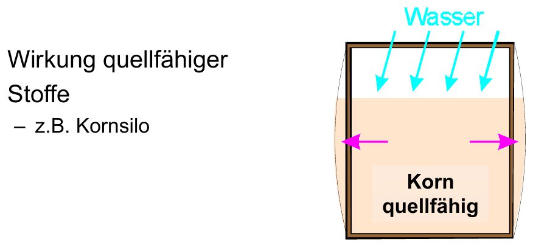
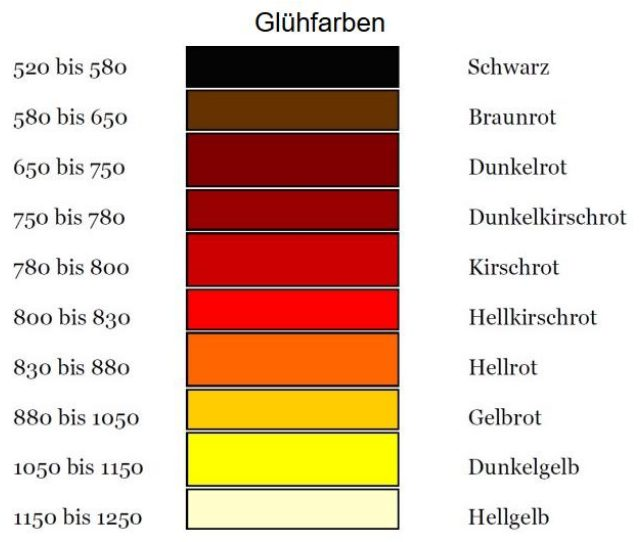
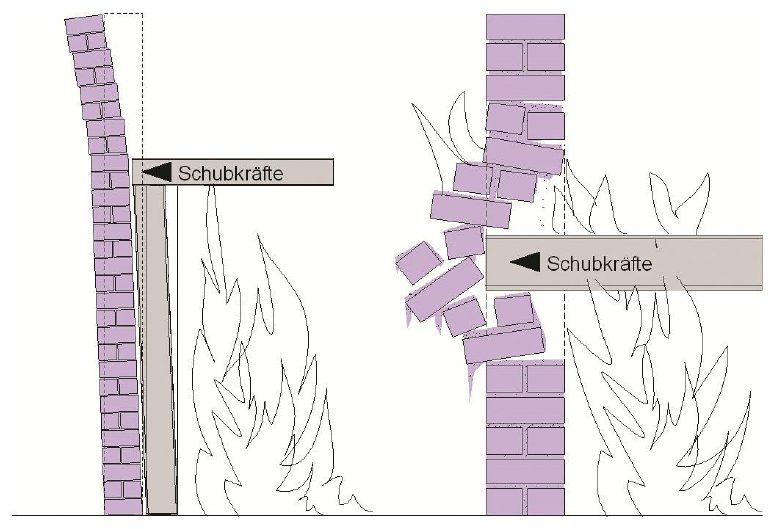
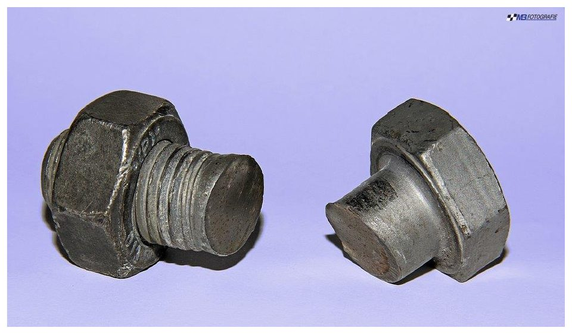
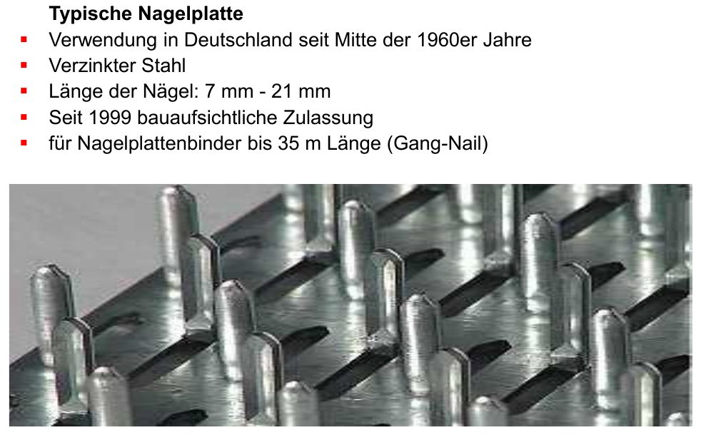
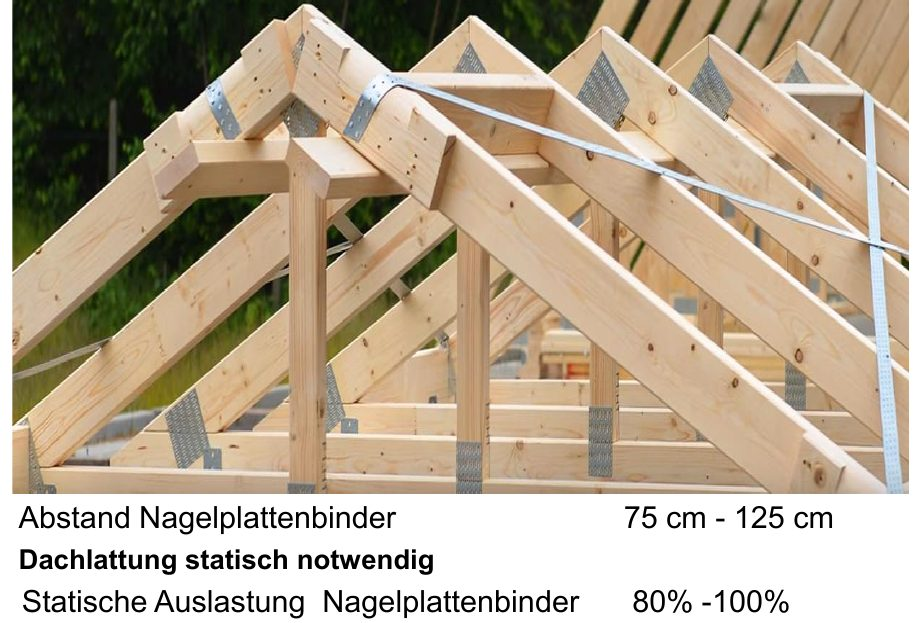
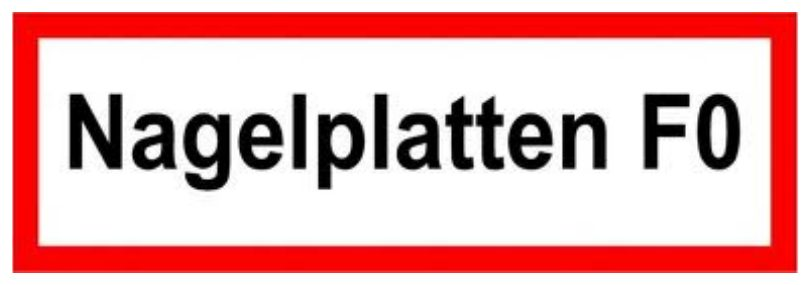

# Einsturz

## Begriff

„Einsturz“ umfasst das **In-sich-Zusammenfallen** von Gebäuden oder Bauteilen, das Umkippen von Bauteilen (Giebel, Schornsteine) oder Gegenständen (Bäume, Masten) sowie das Abrutschen von Erdmassen und Schüttgut.

## Ursachen

*Quellfähige Stoffe sprengen den Behälter (Folie 203)*

- **Schwächung der Tragkraft:** Abbrand von Holz, Erwärmung von Stahl, Strukturveränderung von Stein
- Lockerung des Baugefüges, von Verankerungen und Querverbänden
- **Überlastung** durch Löschwasser, Brandschutt oder Teileinstürze
- **Quellfähige Stoffe** (z. B. Korn im Silo saugt Löschwasser auf und sprengt den Behälter)
- **Witterung:** Wind auf freistehende Bauteile
- **Eisbildung** (+ ca. 10 % Volumen) und **Wasserdampf** (1 l Wasser → ca. 1700 l Dampf) drücken Bauteile auseinander
- Löschtaktische Fehler

## Baustoffe im Brand

### Holz

- Gast bei Erwärmung aus (Holzgas) und bildet Holzkohle; Zündtemperatur 240–300 °C, nach längerer Vorwärmung bis auf ca. 110 °C absinkend.
- Brandverhalten abhängig von ätherischen Ölen, Wassergehalt, Oberfläche, Querschnitt, Holzart (Hart-/Weichholz).
- Abbrand ca. 1 mm/min, Leimholz 0,5 mm/min (Werte laut Folien).
- Einsturzgefahr, wenn der Querschnitt um mehr als 50 % abgebrannt ist.
- Kündigt Versagen meist durch Knacken und Krachen an („Holzschrei“); Balken sind mit doppelter Sicherheit bemessen.

### Stahl

*Glühfarben von Stahl (Folie 180)*

*Ausdehnung von Stahl schiebt Wände weg (Folie 181)*

*Abgescherte Verbindungen (Folie 182)*

- Verliert seine Tragfähigkeit ab ca. **500 °C** (kritische Temperatur).
- Dehnt sich aus: **1,2 mm je Meter je 100 K** – schiebt Wände weg, schert Verbindungen ab.
- Zieht sich beim Abkühlen wieder zusammen – auch dann Einsturzgefahr.

### Beton

- **Beton:** Gefügelockerung, Abbröckeln; über 600 °C verliert er seinen Zusammenhalt.
- **Stahlbeton:** Abplatzungen legen den Bewehrungsstahl frei → Tragfähigkeitsverlust.
- **Spannbeton:** dünne Bauteile mit vorgespanntem Stahl; ab ca. 400 °C erschlafft der Stahl plötzlich → **schlagartiger Einsturz ohne Vorwarnung**.

### Bauteile allgemein

- Knotenpunkte von Holzkonstruktionen (Dachstühle) brennen durch.
- Verankerungen reißen durch Längenänderung ab.
- Freigebrannte Schornsteine und Giebelwände verlieren ihre Standfestigkeit.

## Nagelplattenbinder (z. B. Supermärkte, Hallen)

*Typische Nagelplatte (Folie 188)*

*Dachkonstruktion mit Nagelplattenbindern (Folie 190)*

*Gefahrhinweis-Schild „Nagelplatten F0“ (Folie 196)*

- Seit Mitte der 1960er verwendet: verzinkte Stahlplatten mit 7–21 mm langen Nägeln verbinden sägeraues Bauholz (5–6 cm breit) im stumpfen Stoß; Binder bis 35 m Länge.
- Binderabstand 75–125 cm, statische Auslastung 80–100 %, Dachlattung statisch notwendig.
- Im Brand: Holz um die Nägel brennt weg, die Platte fällt ab → Knoten versagt.

### Typischer Brandverlauf

- Häufig Brandstiftung an der Warenannahme; das Feuer dringt schnell ins Dach ein (oder Rauch über Installationen).
- Ist das Feuer im Dach: fast immer **Totaleinsturz in wenigen Minuten, meist unter 20 min** nach Brandausbruch.

### Einsatztaktik

> [!GEFAHR] Bei Nagelplattenbindern jederzeit Einsturzgefahr – **Innenangriff ist extrem gefährlich**.

- Märkte werden meist vor Eintreffen vom Personal geräumt; ist Rauch im Verkaufsraum, sind die Waren ohnehin verloren.
- Löschangriff möglichst von außen, Riegelstellung zur Nachbarbebauung.
- Notfalls kontrolliert abbrennen lassen.
