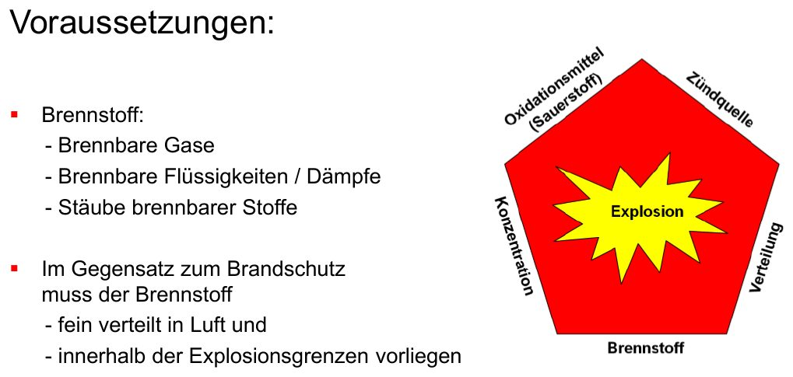
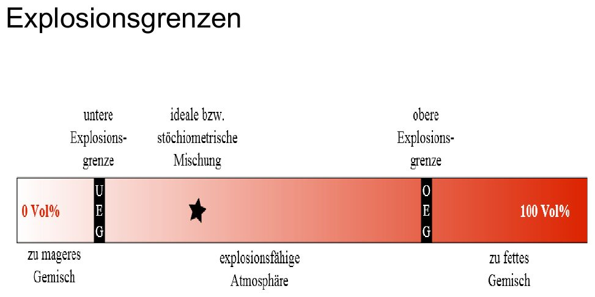
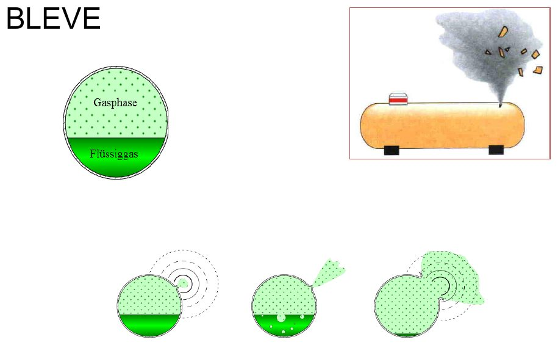

# Explosion

## Was ist eine Explosion?

Eine plötzliche Oxidations- oder Zerfallsreaktion mit Anstieg der Temperatur, des Drucks oder beidem.

### Wodurch entsteht Explosionsgefahr?

- Zündung von Sprengstoff und Munition
- Freisetzung von Gasen und Dämpfen
- Aufwirbeln von Stäuben und Ablagerungen
- Rauchgasansammlung in Gebäuden
- Bersten von Druckbehältern
- Falsche Löschmittel

### Voraussetzungen

*Voraussetzungen einer Explosion (Folie 209)*

Brennstoff (brennbare Gase, Dämpfe, Stäube) muss – anders als beim normalen Brand – **fein verteilt in Luft** und **innerhalb der Explosionsgrenzen** vorliegen, dazu eine Zündquelle.

## Explosionsgrenzen

*Zu mager – explosionsfähig – zu fett (Folie 210)*

Unter der **UEG** (untere Explosionsgrenze) ist das Gemisch zu mager, über der **OEG** (obere Explosionsgrenze) zu fett – dazwischen ist es explosionsfähig.

| Stoff | UEG | OEG |
|---|---|---|
| Acetylen | 1,5 Vol.-% | 83 Vol.-% |
| Wasserstoff | 4,0 Vol.-% | 75,6 Vol.-% |
| Kohlenmonoxid | 12,5 Vol.-% | 75 Vol.-% |
| Propan | 2,1 Vol.-% | 9,5 Vol.-% |
| Benzin | 0,6 Vol.-% | 8,0 Vol.-% |
| Diesel | 0,6 Vol.-% | 6,5 Vol.-% |
| Holzstaub / Weizenmehl | 20–50 g/m³ | – |

## Zündquellen

- Flammen: offenes Feuer, Zigaretten, Glutnester, Schweißen, Brenner
- Heiße Oberflächen: Motoren, Heizungen, Föhn
- Elektrische Energie: Licht, Lichtschalter, Klingel, Geräte
- Lichtbögen, elektrostatische Aufladung (Schuhe), Blitzschlag
- Strahlung: Handy, Funkgerät, Ultraschall
- Chemische Reaktionen mit Wärmeentwicklung (Säure + Lauge)
- Mechanische Funken (funkenreißendes Werkzeug)

## Gefahren für Menschen

| Ursache | Folge |
|---|---|
| Flammen und heiße Gase | Verbrennungen |
| Druckwelle | Verletzungen |
| Toxische Gase | Vergiftungen |
| Sauerstoffverbrauch | Ersticken |

Dazu: Fortschleudern und Absturz von Personen, Trümmerflug, Gebäudeeinsturz, Freisetzung gefährlicher Stoffe, Folgebrände und Umweltschäden.

## Arten nach Stärke

| Art | Druck | Geschwindigkeit | Folgen |
|---|---|---|---|
| **Verpuffung** | bis ca. 1 bar | langsame Flammenfront | meist Prellungen, Brand- und Schnittverletzungen |
| **Deflagration** | ca. 1–14 bar | bis einige 100 m/s | teilweise bis vollständige Zerstörung von Gebäuden, schwere Verletzungen bis Tod |
| **Detonation** | bis ca. 100 bar | einige km/s | Zerstörung in weitem Umkreis, im direkten Bereich keine Überlebenschance (Sprengstoffe) |

## Sonderformen

### BLEVE (Druckbehälterzerknall)

*Ablauf eines BLEVE (Folie 226)*

Ein beheizter Flüssiggasbehälter birst: Trümmerteile fliegen wie Schrapnelle bis zu 500 m weit, die Flüssigkeit verdampft schlagartig und zündet – Feuerball bis ca. 80 m hoch und 50 m breit.

#### Maßnahmen bei Wärmeeinwirkung auf Druckbehälter

- Flasche ggf. aus dem Gefahrenbereich bringen
- Temperatur aus Deckung kontrollieren (Wärmebildkamera)
- Aus Deckung großflächig mit Sprühstrahl kühlen, bis das Wasser nicht mehr verdampft; Strahlrohre/Werfer mit großer Wurfweite
- So wenig Kräfte wie möglich im Gefahrenbereich; beim Aufstellen von Werfern Hitzeschutzkleidung
- Gefahrenbereich räumen (Flüssiggastank: bis 500 m)

> [!GEFAHR] Zu Beginn der Kühlung oder bei Vollstrahl kann der Behälter durch Spannungsrisse bersten. **Spricht das Sicherheitsventil an, steht der Zerknall unmittelbar bevor!**

### Fettexplosion

Wasser trifft auf brennendes Fett, verdampft schlagartig und reißt das Fett als Feuerball mit.

### Staubexplosion

Möglich mit Kohle, Mehl, Holz, Kaffee, Kakao, Stärke, Cellulose sowie Metallstäuben (Magnesium, Aluminium, Eisen).

## Maßnahmen bei Explosionsgefahr

| Lage | Maßnahmen |
|---|---|
| Explosionsfähige Atmosphäre | Deckung suchen, absperren und räumen, Zündquellen ausschließen, querlüften |
| Stichflamme / Rauchgasdurchzündung | Wasser am Strahlrohr, gebückt vorgehen, Türen richtig öffnen, Raumtemperatur senken, lüften |
| Druckgefäßzerknall | Deckung suchen, Behälter kühlen, Bereich absperren/räumen |
| Staubexplosion | Aufwirbeln vermeiden, Sprühstrahl, **keine** Belüftung |
