# Knoten und Stiche

Mit der Feuerwehrleine werden Leinen **verbunden**, Leinen an Gegenständen **festgelegt**, Geräte **hochgezogen** und Menschen **gerettet oder gesichert**. Für jeden Zweck gibt es den passenden Knoten.

## Überblick

| Knoten / Stich | Wofür? |
|---|---|
| **Kreuzknoten** | zwei Leinen **gleichen** Materials verbinden |
| **Schotstek** | zwei Leinen **gleichen oder ungleichen** Materials verbinden |
| **Doppelter Ankerstich** | Leine an Stange/Pfahl festlegen – Aufziehen von Schläuchen, Äxten, Geräten |
| **Mastwurf** | Leine an Stange/Pfahl festlegen |
| **Zimmermannstich** | Mehrzweckleine am Saugkorb, an Pfählen, Stämmen; Hochziehen von Rundhölzern/Balken |
| **Palstek** (Pfahlstich, *Rettungsknoten*) | Schlinge, die sich nicht zuzieht – Rettung und Sicherung von Menschen |
| **Brustbund** | Sichern/Retten einer Person mit der Feuerwehrleine |
| **Spierenstich** | zwei etwa gleich dicke Seile verbinden; einen Knoten sichern |
| **Achterknoten** | aus der Bergsteigerei; als Schlinge (doppelter Achter) |
| **Halbschlag** | andere Stiche sichern; Geräte beim Hochziehen festlegen/stabilisieren |
| **Halbmastwurf** | dynamische Sicherung im Karabiner (Abseilen, Halten, Auffangen) |

## Leinen verbinden

### Kreuzknoten
Verbindet zwei Leinen **gleichen Materials**. Er ist leicht zu binden und **zieht sich nicht zu**.

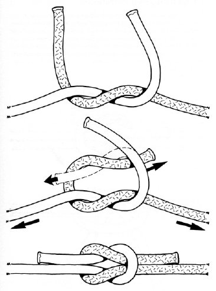
*Kreuzknoten (Seite 1)*

### Schotstek
Verbindet zwei Leinen **gleichen oder ungleichen Materials**. Leicht zu binden, zieht sich nicht zu – er **kann aber slippen**, wenn er nicht richtig gebunden wird. Es gibt ihn auch mit Aufzugschlaufe (geslippt).

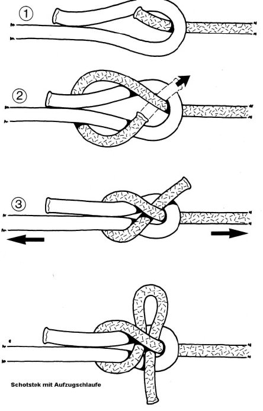
*Schotstek, unten mit Aufzugschlaufe (Seite 1)*

### Spierenstich
Verbindet zwei **etwa gleich dicke** Seile. Er kann auch zur **Sicherung eines Knotens** dienen.

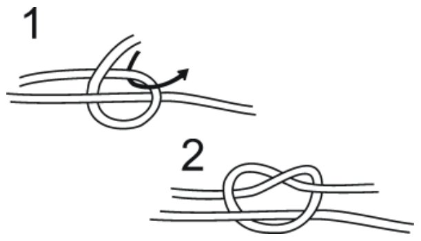
*Spierenstich (Seite 5)*

> [!MERKE] **Kreuzknoten** = gleiches Material · **Schotstek** = gleiches **oder ungleiches** Material.

## Leine festlegen

### Doppelter Ankerstich
Legt die Feuerwehrleine an einer **Stange, einem Pfahl** oder einem anderen Gegenstand fest. Er wird **gelegt oder gebunden (gestochen)** und kann – wie der Mastwurf – an **jeder beliebigen Stelle** der Leine angebracht werden. Hauptsächlich beim **Aufziehen von Schlauchleitungen, Äxten** und anderen Geräten.

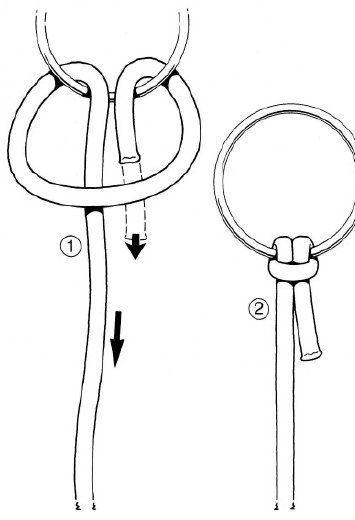
*Doppelter Ankerstich (Seite 2)*

### Mastwurf
Legt die Feuerwehrleine an einer Stange, einem Pfahl oder einem anderen Gegenstand fest. Wird **gelegt oder gestochen**. Auch das Zugseil (Hanfseil) der Schiebleiter wird mit einem Mastwurf gesichert.

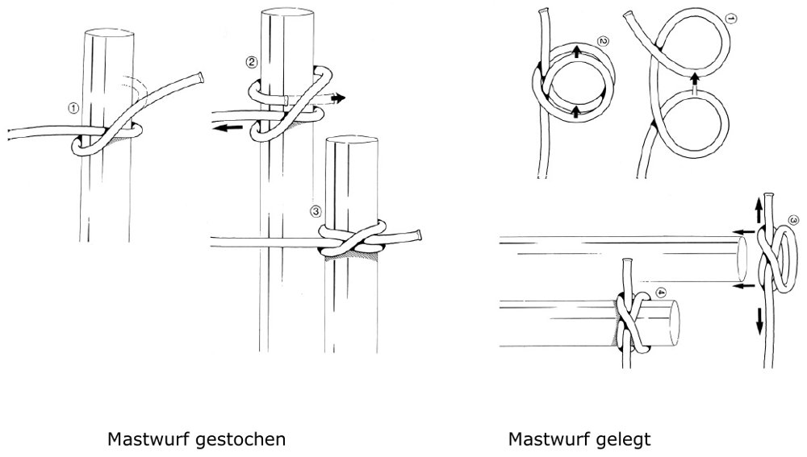
*Mastwurf gestochen (links) und gelegt (rechts) (Seite 2)*

### Zimmermannstich
Zum Befestigen der **Mehrzweckleine am Saugkorb**, an Pfählen, Stämmen und Baukonstruktionen sowie zum **Hochziehen von Rundhölzern und Balken**.

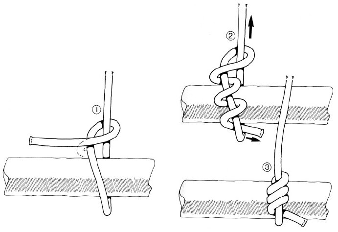
*Zimmermannstich (Seite 3)*

### Halbschlag
Der „halbe Schlag“ **sichert andere Stiche** oder legt Geräte und Gegenstände fest bzw. stabilisiert sie, z. B. beim **Hochziehen**. Varianten: einfacher Halbschlag, zwei Halbschläge, geslippter Halbschlag.

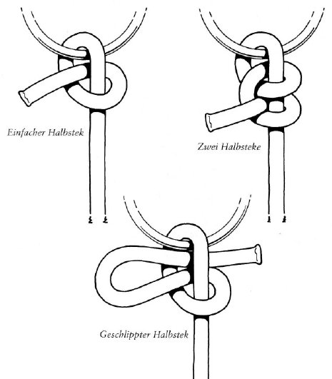
*Einfacher Halbschlag, zwei Halbschläge, geslippter Halbschlag (Seite 6)*

## Menschen retten und sichern

### Palstek (Pfahlstich, Rettungsknoten)
Befestigt die Feuerwehrleine an Pfählen, Ringen oder Bauteilen – immer dann, wenn diese **nicht von der Schlinge umschlossen** werden sollen. Die Schlinge **zieht sich nicht zu**. Besonders geeignet zur **Rettung und Sicherung von Menschen** – daher „Rettungsknoten“.

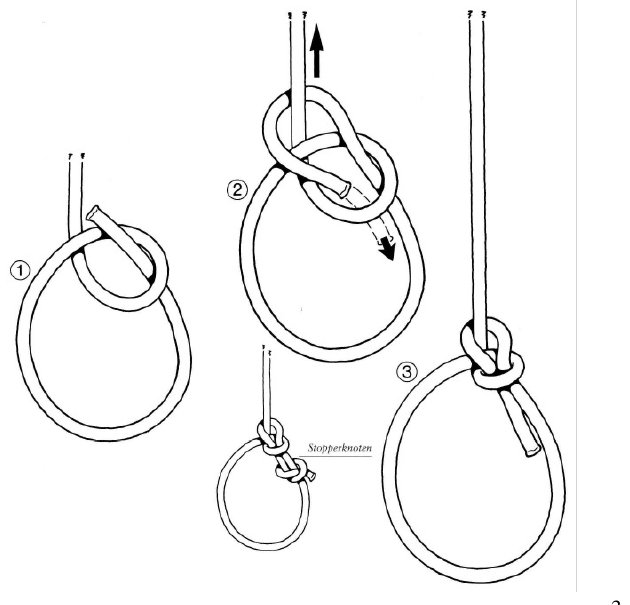
*Palstek in drei Schritten, mit Stopperknoten (Seite 3)*

### Brustbund
Mit dem Brustbund wird eine Person mit der Feuerwehrleine **gesichert oder gerettet** (z. B. zu rettende Personen auf der Leiter). Er wird in sechs Schritten angelegt.

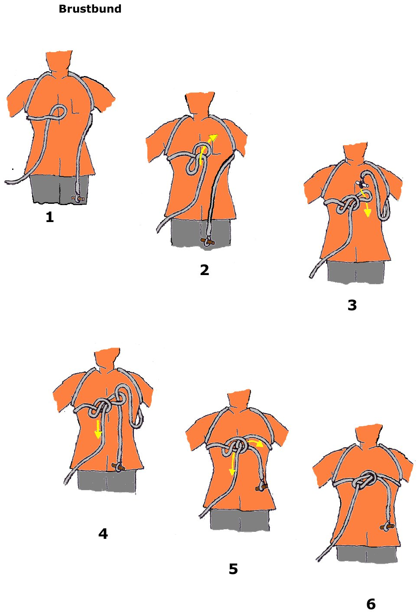
*Brustbund in 6 Schritten (Seite 4)*

### Halbmastwurf
Wird (vor allem mit einem **Karabiner**) als **dynamische Sicherung** zum Abseilen, Halten oder Auffangen verwendet. Er kippt im Karabiner **immer auf die richtige Seite** – er kehrt sich unter Last selbst um.

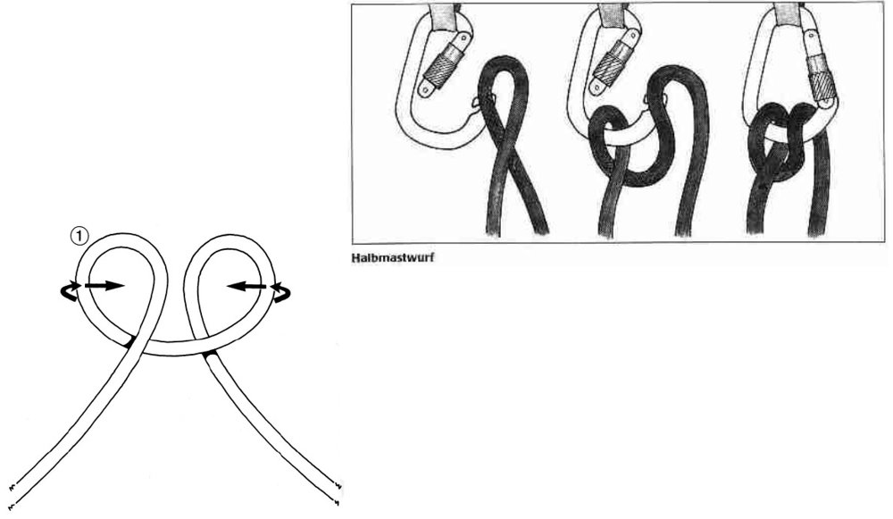
*Halbmastwurf, rechts im Karabiner (Seite 6)*

### Achterknoten
Kommt aus der **Bergsteigerei** und wird beim Klettern in abgewandelter Form – als **Schlinge** (doppelter Achterknoten) – verwendet. Der **nachgesteckte Achterknoten** bildet eine feste Schlinge um einen Ring oder Gegenstand.

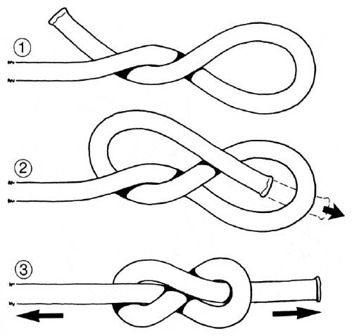
*Achterknoten (Seite 5)*

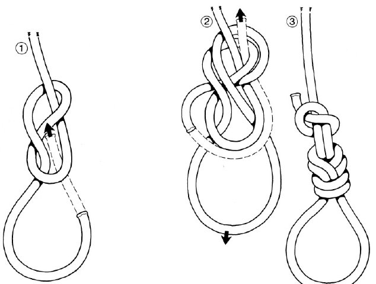
*Achterknoten nachgesteckt (Seite 5)*

## So bitte nicht: der „Feuerwehrverzweiflungsknoten“

Ein bei Übungen und Einsätzen leider oft anzutreffender Knoten, für den es **keinerlei Regeln** gibt. Seine Festigkeit ist so variabel wie sein Aussehen.

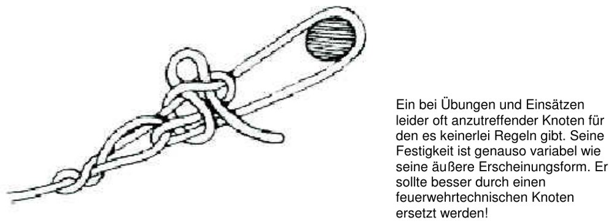
*Feuerwehrverzweiflungsknoten (Seite 7)*

> [!WARNUNG] Er sollte immer durch einen **feuerwehrtechnischen Knoten** ersetzt werden!
