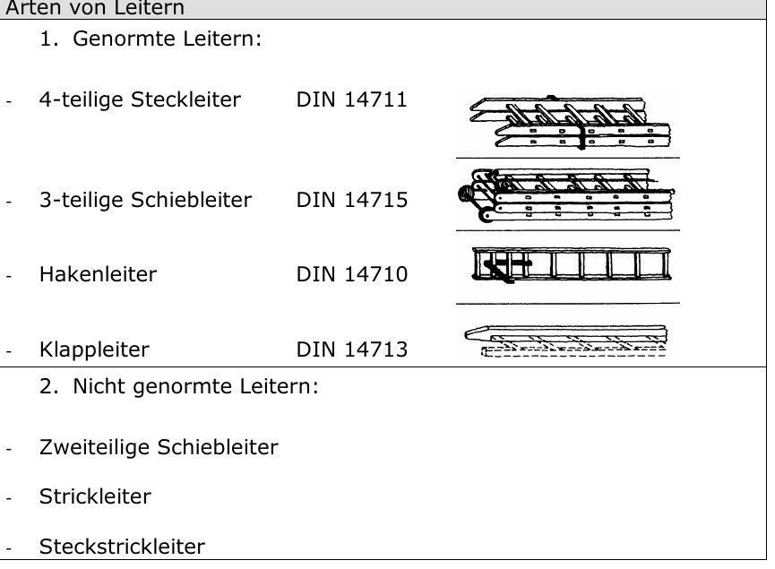
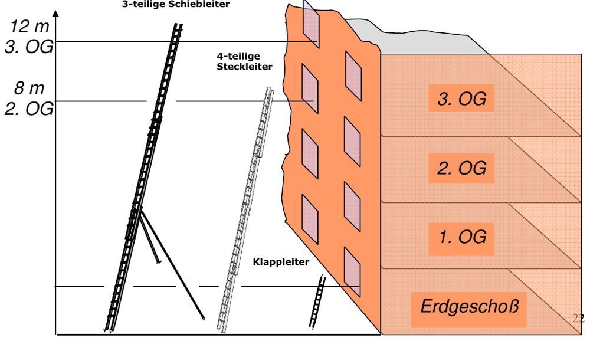
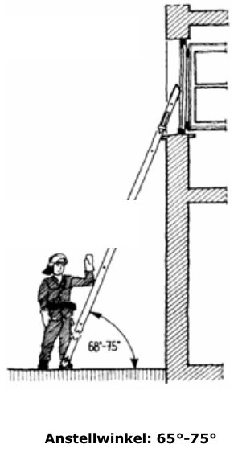
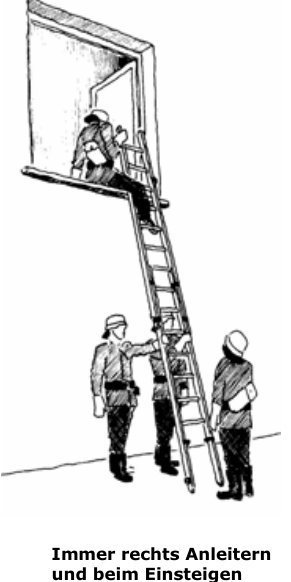
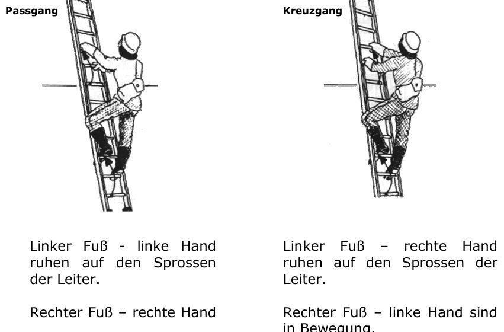

# Tragbare Leitern – Grundlagen

Tragbare Leitern gehören zu den **Rettungsgeräten**. Sie werden auf den Fahrzeugen mitgeführt und an der Einsatzstelle **von der Mannschaft getragen**. Sie dienen der Rettung von Menschen und Tieren, zum Überwinden von Höhenunterschieden und Hindernissen und als Hilfsgeräte – bei der technischen Hilfeleistung ebenso wie bei der Brandbekämpfung.

## Anwendung

Tragbare Leitern dienen als:
- **Rettungsweg**
- **Angriffsweg**
- **Hilfsgerät**

Nutzungsmöglichkeiten:
- im Hausinneren, wenn das Treppenhaus nicht mehr begehbar ist
- im Freien zum Besteigen von Bäumen, Dächern usw.
- zum Einsteigen in Keller und Schächte
- zum Herstellen von Tragen
- zum Bau von Schlauchbrücken

## Arten von Leitern

| Genormte Leitern | Norm |
|---|---|
| 4-teilige **Steckleiter** | DIN 14711 |
| 3-teilige **Schiebleiter** | DIN 14715 |
| **Hakenleiter** | DIN 14710 |
| **Klappleiter** | DIN 14713 |

**Nicht genormt:** zweiteilige Schiebleiter, Strickleiter, Steckstrickleiter.

*Genormte und nicht genormte Leitern (Seite 10)*

## Rettungshöhen im Vergleich

| Leiter | erreicht | Rettungshöhe |
|---|---|---|
| Klappleiter | Erdgeschoss | ca. 1,90 m |
| 4-teilige Steckleiter | **2. OG** | ca. 7 m |
| 3-teilige Schiebleiter | **3. OG** | ca. 12 m |
| Hakenleiter | Geschoss für Geschoss | theoretisch unbegrenzt |
| *zum Vergleich:* Sprungpolster SP 16 | 5. OG | 16 m |

*Rettungshöhen von Schiebleiter, Steckleiter und Klappleiter (Seite 22)*

## Entnahme und Transport

- **Schiebleiter** mit **4 Personen**, **Steckleiter** mit **mindestens 3 Personen** tragen.
- Der **Leiterfuß geht voran**.

## Vornahme (Aufstellen)

- **Standfestigkeit** sicherstellen (fester Untergrund).
- Besondere Vorsicht bei **Freileitungen und elektrischen Anlagen** (Abstände siehe *Einsatzgrundsätze*).
- **Anstellwinkel 65° – 75°**.
- So anstellen, dass **3 Sprossen über dem Einstiegsniveau** liegen.
- Bei Fenster- und Wandöffnungen **immer einseitig rechts** anleitern.
- Leiter im Fenster möglichst mit **Bindestricken oder Schlauchhaltern** zusätzlich sichern.

*Anstellwinkel 65°–75° (Seite 11)*

> [!MERKE] **65–75°** Anstellwinkel · **3 Sprossen** über Einstieg · **rechts** anleitern.

## Besteigen

- **Steckleiter**: beim Besteigen von **1 Person** sichern.
- **Schiebleiter**: beim Besteigen von **2 Personen** sichern.
- **Klapp- und Hakenleiter**: nur mit **1 Person** besteigen.
- **Steck- und Schiebleiter**: höchstens mit **2 Personen** besteigen.
- An den Sprossen hochziehen (**Ristgriff**).
- Körper dicht an der Leiter, **Knie nach außen**.
- Möglichst im Rhythmus steigen (**Kreuz- oder Passgang**).
- Schiebleiter im Freistand **nicht über die Stützstangen hinaus** besteigen.
- Leitern **niemals über den Auflagepunkt hinaus** besteigen.
- Einsteigen ins Fenster/auf den Balkon im **Reitsitz** – der Fuß ertastet den festen Boden.

*Immer rechts anleitern und beim Einsteigen den Reitsitz anwenden (Seite 11)*

### Passgang und Kreuzgang

| Passgang | Kreuzgang |
|---|---|
| **Linker Fuß + linke Hand** ruhen auf den Sprossen, rechter Fuß + rechte Hand bewegen sich | **Linker Fuß + rechte Hand** ruhen auf den Sprossen, rechter Fuß + linke Hand bewegen sich |

*Passgang (links) und Kreuzgang (rechts) (Seite 22)*
