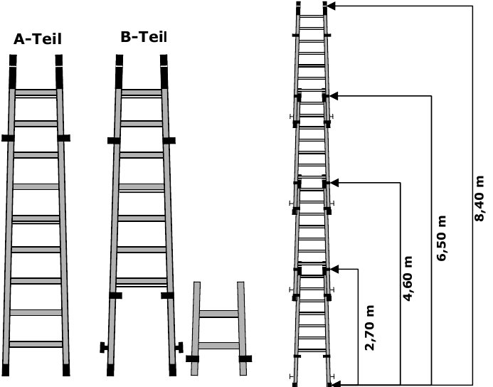
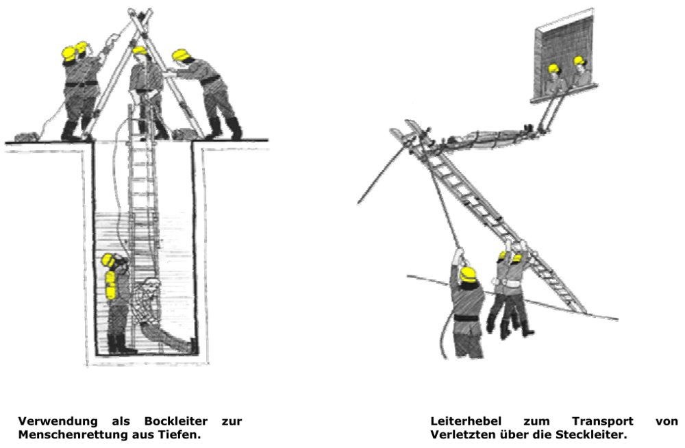
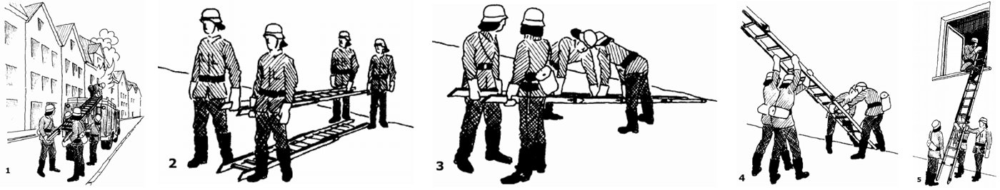
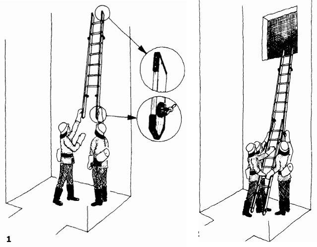

# Die 4-teilige Steckleiter

Die Steckleiter (DIN 14711) dient als **Angriffs- und Rettungsweg bis zum 2. OG**. Es dürfen **maximal 4 Leiterteile** zusammengesteckt werden.

## Aufbau

- Jedes Leiterteil hat **2 Holme und 7 Sprossen**.
- **Kästen** an den Holmen ermöglichen das Zusammenstecken.
- **Federsperrbolzen** mit Griff verriegeln die Leiterteile.
- Aus **Leichtmetall oder Holz**; Holz- und Metallteile müssen **gegeneinander austauschbar** sein.

## Daten

| Leiterteile | 1 | 2 | 3 | 4 |
|---|---|---|---|---|
| Rettungshöhe | ca. 2,10 m | ca. 3,40 m | ca. 5,00 m | ca. **7,00 m** |
| Länge | 2,70 m | 4,60 m | 6,50 m | **8,40 m** |

Gewicht pro Leiterteil: **10 kg** (Leichtmetall), **14 kg** (Holz).

*A-Teil, B-Teil und Längen mit 1–4 Leiterteilen (Seite 13)*

> [!MERKE] Früher gab es **A- und B-Teile** – heute werden **nur noch B-Teile** verwendet. Bei gemischtem Einsatz kommen **Holzteile immer unter die Metallteile**.

## Weitere Anwendungen

- als **Bockleiter**, um Zäune, Mauern und Hindernisse zu überwinden – oder zur **Menschenrettung aus Tiefen**
- als **behelfsmäßige Krankentrage** bzw. **Leiterhebel** zum Transport von Verletzten
- zur **Eisrettung** (verteilt das Gewicht des Helfers auf eine große Fläche)
- für **Schlauchüberführungen**
- zum Überqueren kleiner Vertiefungen (Bäche, Risse)
- als provisorische **Ölsperre**
- zum **Anstauen** von Gewässern (mit Plane)

*Bockleiter zur Rettung aus Tiefen und Leiterhebel (Seite 17)*

## Kommandos

| Vornahme | Zurücknahme |
|---|---|
| „Steckleiter – **vom Fahrzeug!**“ | „Steckleiter – **legt ab!**“ |
| „Steckleiter – **marsch!**“ | „Steckleiter – **zum Abmarsch fertig!**“ |
| „Steckleiter – **halt!**“ | „Steckleiter – **hoch!**“ |
| „Steckleiter – **steckt ein!**“ | „Steckleiter – **zum Fahrzeug!**“ |
| „Steckleiter – **richtet auf!**“ | „Steckleiter – **halt!**“ |
| | „Steckleiter – **auf das Fahrzeug!**“ |

## Vornahme Schritt für Schritt

Möglich mit 3 oder 4 Personen – die Regel ist die Vornahme durch **2 Trupps**.

1. Beide Trupps nehmen die Leiter mit Hilfe des **Maschinisten** vom Fahrzeug und tragen **alle Teile** – **Leiterfuß voraus** – zum Objekt. Ablage **einen Schritt vor dem Objekt** unterhalb der Einstiegsöffnung.
2. Kehrtwendung; die oberen Leiterteile werden bis zum Kopfende der unteren getragen – am besten **an den Sprossen**, nicht an den Holmen.
3. Der Trupp am Kopfende **steckt die Teile zusammen** (auf Verriegelung der **Federsperrbolzen** achten!). Braucht man nur 3 Teile, werden erst alle 4 zusammengesteckt und dann eines abgenommen.
4. Ein Trupp richtet die Leiter an den Holmen auf, der andere zieht am unteren Leiterteil mit; beide stützen mit je einem Fuß ab.
5. Der befohlene Trupp **steigt auf und ein**, der 2. Trupp **sichert** (oder der vorgehende Trupp sichert selbst).

*Vornahme der Steckleiter, Schritte 1–5 (Seite 14–15)*

## Vornahme auf engem Raum (Untersetzen)

1. Leiter zum Objekt bringen und in **vier Teile zerlegen**. Der Trupp hebt ein Teil (Schrägfläche zum Objekt) an den waagerechten Federsperrbolzen hoch und legt es möglichst schräg an.
2. Das nächste Teil wird **von unten in die Kästen eingeschoben**, die Federsperrbolzen durch Drehen einrasten lassen. Weitere Teile genauso untersetzen.

Die Zurücknahme erfolgt in umgekehrter Reihenfolge.

*Vornahme auf engem Raum durch Untersetzen (Seite 16)*
