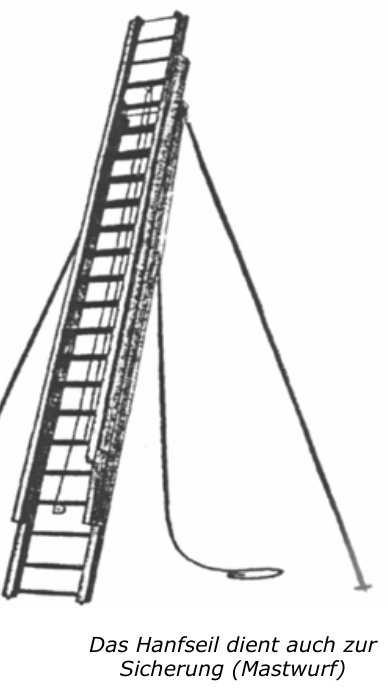
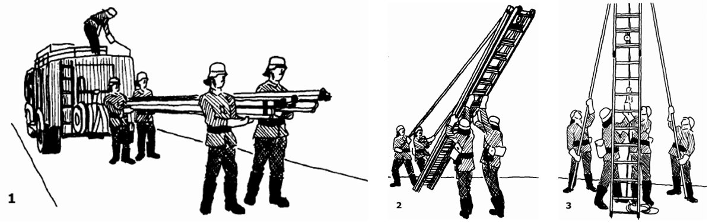

# Die 3-teilige Schiebleiter

Die Schiebleiter (DIN 14715) ist eine **3-teilige, ausziehbare Anstellleiter**. Für den Einsatz werden **4 Personen** benötigt. Sie erreicht das **3. OG**.

## Aufbau

- **Drei aufeinander laufende** Leiterteile (Unter-, Mittel-, Oberleiter).
- Ausgezogen über einen **doppelten Seilzug**:
  - **Mittelleiter** über ein **Hanfseil**,
  - **Oberleiter** über ein **Stahlseil**.
- Die Seile laufen über **Rollen**.
- **Fallhaken** am unteren Ende von Mittel- und Oberleiter.
- Zwei **Stützstangen** am Kopfteil der Unterleiter (Drehgelenke) – für die Sicherheit.
- Ausführung in **Holz oder Leichtmetall**.

> [!MERKE] **Hanfseil → Mittelleiter**, **Stahlseil → Oberleiter**. Das Hanfseil dient auch zur Sicherung (**Mastwurf**).

## Daten

| | |
|---|---|
| Rettungshöhe | ca. **12,20 m** (3. OG) |
| Gewicht | ca. **100 kg** (Holz), ca. **75 kg** (Leichtmetall) |
| Transportlänge | **5,60 m** |
| Einsatzlänge | **14,00 m** |

*Schiebleiter mit Stützstangen; das Hanfseil dient auch zur Sicherung (Mastwurf) (Seite 18)*

> [!ACHTUNG] Die Schiebleiter darf im **Freistand nicht über den Stützpunkt** (die Stützstangen) hinaus bestiegen werden!

## Kommandos

| Vornahme | Zurücknahme |
|---|---|
| „Schiebleiter – **vom Fahrzeug!**“ | „Schiebleiter – **legt ab!**“ |
| „Schiebleiter – **marsch!**“ | „Schiebleiter – **zum Abmarsch fertig!**“ |
| „Schiebleiter – **halt!**“ | „Schiebleiter – **hoch!**“ |
| „Schiebleiter – **richtet auf!**“ | „Schiebleiter – **zum Fahrzeug!**“ |
| „Schiebleiter – **zieht aus!**“ | „Schiebleiter – **halt!**“ |
| „Schiebleiter – **legt an!**“ | „Schiebleiter – **auf das Fahrzeug!**“ |

> [!INFO] Unterschied zur Steckleiter: Statt „steckt ein!“ heißt es bei der Schiebleiter „richtet auf!“ → „**zieht aus!**“ → „**legt an!**“.

## Vornahme Schritt für Schritt

1. Vornahme durch **2 Trupps**. Mit Hilfe des Maschinisten vom Fahrzeug nehmen und – **Leiterfuß voraus** – zum Objekt tragen, **auf den Schultern oder im Unterarm**.
2. Leiterfuß im je nach Einstiegshöhe nötigen Abstand unterhalb der Einstiegsöffnung ablegen. Ein Trupp löst die Halteriemen, nimmt die **Stützstangen** hoch und sichert den Leiterfuß. Ein Trupp richtet auf, der andere zieht an den Stützstangen mit. Die Leiter wird **senkrecht** gestellt, die Stützstangen stehen seitlich zum Objekt.
3. Ein Trupp sichert an den Stützstangen. Der andere löst das Zugseil, **zieht die Leiter auf die nötige Höhe aus**, achtet auf das **Aufsetzen der Fallhaken** und den sicheren Stand und befestigt das Zugseil mit einem **Mastwurf**. Dann wird die Leiter **angelegt**; die Stützstangen werden seitlich so ausgerichtet, dass sich die Leiter nicht durchbiegt oder verschiebt.

Die Zurücknahme erfolgt in umgekehrter Reihenfolge.

*Vornahme der Schiebleiter, Schritte 1–3 (Seite 18–19)*
