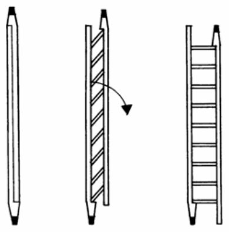
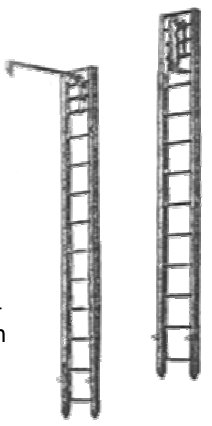
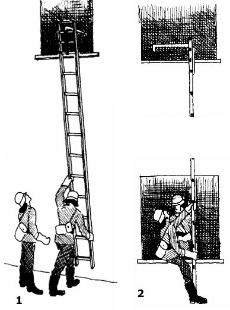

# Klappleiter und Hakenleiter

## Die Klappleiter (DIN 14713)

Die Klappleiter ist die **einzige Feuerwehrleiter, die bei der Verladung länger ist als im Betrieb**.

### Aufbau
- **2 Holme und 9 Sprossen**; die Sprossen sind drehbar eingelassen, sodass die Holme gegeneinander geklappt werden können.
- Holme **doppelt verstärkt**.
- Sprossen an der Trittseite mit **2 mm Stahlblech** belegt.

### Anwendung
- kleine Höhenunterschiede überwinden
- als **Rammbock**
- als **Behelfsbrücke**
- als **Behelfskrankentrage**
- zum **Abstützen** von Lasten
- als **Hebelstange**

### Daten

| | |
|---|---|
| Rettungshöhe | ca. **1,90 m** |
| Gewicht | max. **10 kg** |
| Länge zusammengeklappt | **3,26 m** |
| Länge auseinandergeklappt | **3,00 m** |
| Breite | 0,32 m |
| Sprossenabstand | 0,30 m |

*Klappleiter zusammengeklappt und aufgeklappt (Seite 19)*

### Vornahme
Die Vornahme erfolgt durch **einen Feuerwehrmann**. Maschinist und Feuerwehrmann nehmen die Leiter vom Fahrzeug, der Feuerwehrmann bringt sie zum Objekt, **klappt sie durch leichtes Aufstoßen auf den Boden auseinander**, stellt sie an und steigt auf.

> [!ACHTUNG] **Quetschgefahr für die Finger** beim Auseinanderklappen!

## Die Hakenleiter (DIN 14710)

Hakenleitern dürfen **nur zum Senkrechtsteigen** benutzt werden. **Als Anstellleiter darf sie nicht verwendet werden (Holmbruch)!** Sie ist theoretisch an keine Höhe gebunden – man steigt Geschoss für Geschoss.

### Aufbau
- 2 Holme, **10 Steigsprossen, 3 Hakensprossen, 1 Decksprosse**.
- **Metallhaken 0,70 m** lang mit **0,15 m Nase**; an der Unterkante **12 Zähne im Abstand von 4 cm**.
- Der Haken ist **klappbar**: am Steg angelegt oder im 90°-Winkel abgeklappt.

### Anwendung
Dort, wo andere Leitern nicht oder nur sehr schwer in Stellung gebracht werden können. Als Übungsgerät fördert sie **Sicherheit und Gewandtheit beim Steigen**.

### Daten

| | |
|---|---|
| Rettungshöhe | theoretisch unbegrenzt |
| Gewicht | **9 kg** (Haken aus Leichtmetall), **10 kg** (Haken aus Stahl) |
| Länge | **4,40 m** |
| Breite | 0,29 m |
| Sprossenabstand | 0,36 m |

*Hakenleiter (Seite 21)*

### Vornahme
Durch **zwei Mann**. Mit Hilfe des Maschinisten vom Fahrzeug nehmen; einer trägt sie – **Haken voran und nach innen gerichtet** – zum Objekt. Dort wird sie aufgerichtet, an den Holmen hochgehoben und eingehängt.

Beide steigen nacheinander auf. Der erste steigt ein; der zweite hantelt die Leiter an den Holmen hoch und hängt sie im nächsten Geschoss ein, während der andere ihn **am Sicherheitsgurt festhält**. So geht es Geschoss für Geschoss weiter. Zurücknahme in umgekehrter Reihenfolge.

> [!WARNUNG] Beim **Einschlagen von Fensterscheiben nicht nach oben schauen!**

*Vornahme der Hakenleiter (Seite 21)*
