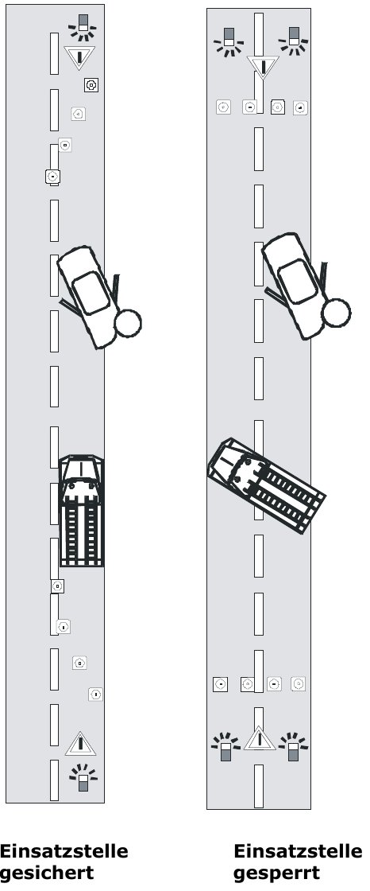

# Absicherung gegen fließenden Verkehr

- Die **Warndreiecke** stellt der **Wassertrupp** auf.
- Warndreiecke werden **vor und nach** der Unfallstelle aufgestellt.
- **Verkehrsleitkegel (Pylonen)** stehen ab **30 m vor dem Feuerwehrfahrzeug**.
- Die **ersten drei Kegel** bilden eine **Kurve vom Fahrbahnrand zur Fahrbahnmitte**, die weiteren stehen auf Höhe des Fahrzeugs (Fahrbahnmitte).
- Am **ersten und dritten Kegel** zusätzlich **Warnleuchten**.

## Abstand der Warndreiecke (laut Handout)

| Wo? | Abstand |
|---|---|
| innerhalb geschlossener Ortschaften | **50 – 100 m** |
| außerhalb geschlossener Ortschaften | **150 – 200 m** |
| Autobahn | **600 m** |

<!-- ausgeblendet:
> [!HINWEIS] Im Thema *Gefahren der Einsatzstelle* stehen leicht andere Werte. Im Zweifel beim Ausbilder nachfragen, welche Werte in der Prüfung gelten.
-->

*Einsatzstelle gesichert (links) und gesperrt (rechts) (Seite 23)*

> [!MERKE] Pylonen **30 m** vor dem Fahrzeug · erste **3 Kegel als Kurve** · Warnleuchten am **1. und 3. Kegel** · Warndreiecke: **Wassertrupp**.
